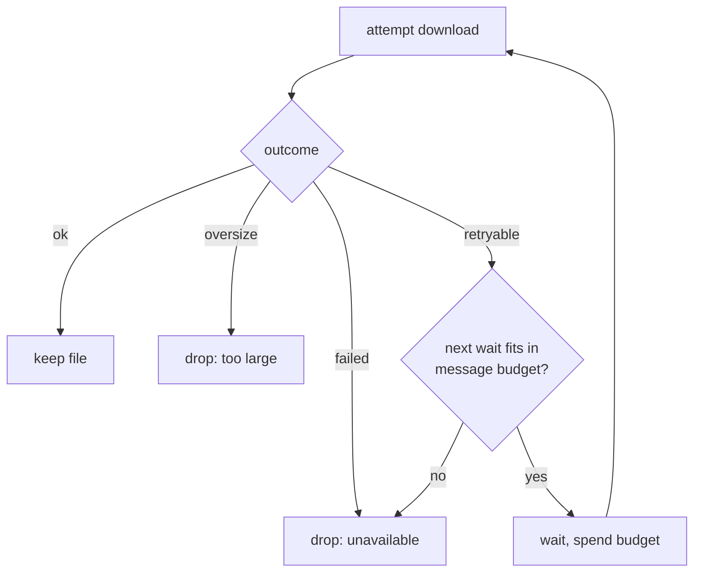

# Teams Dropped Attachments - Plan

## Goal Capsule

- **Objective:** An image an editor attaches in Teams reaches the agent even when SharePoint is still saving it, and when an attachment cannot be read after all, the agent knows it was dropped and why.
- **Means:** retry transient download failures within one shared per-message wait budget (KTD1, KTD2, KTD3), and pass a note about dropped attachments to the agent through `core.Message.ExtraContent` (KTD4).
- **Authority:** the origin brief `docs/brainstorms/2049-requirements.md` wins on product behavior and its tripwire list; KTDs win on mechanism within it.
- **Stop conditions:** any change needed outside `platform/teams/` (except `CHANGES.md`), any change to editor-visible text, any Teams config key change, or any new Graph/Bot Framework permission → write the question under `## Open questions` in `docs/brainstorms/teams-dropped-attachments-decisions.md`, commit, push, and stop.
- **Execution profile:** Go, `platform/teams/` only; tests use the existing `httptest` servers and the `fakeSender` / `fakeGraph` stubs.
- **Finishes and ships:** `ce-work` implements and commits on `taras/teams-dropped-attachments`; the PR into `downstream` is shipped by the pipeline.

---

## Product Contract

### Summary

Downloads of inbound Teams attachments are retried when the failure looks transient, so a channel file SharePoint has not finished committing still reaches the agent. When an attachment is dropped anyway, the agent receives a short note naming the file and the reason, on both the 1:1 and the channel path. The editor-facing warning is unchanged.

### Problem Frame

On 2026-09-07 an image attached in a Teams channel got `404` from the Graph content GET because SharePoint had not finished committing it; the bot posted its warning and ran the turn with empty content. Re-sending the same file about 70 s later worked. The agent, given nothing, then told the editor no attachment had reached it, contradicting the bot's own warning (see origin: docs/brainstorms/2049-requirements.md).

### Requirements

**Retry (ch#1661)**

- R1. A channel file whose content GET fails transiently and later succeeds reaches the agent, and no warning is posted.
- R2. A file that fails on every attempt is skipped and `attachmentFailureNotice` is posted, as today.
- R3. A file over the size cap is not retried; it is skipped with the warning, as today.
- R4. Retries never delay the webhook acknowledgement.
- R5. When one attachment of a message keeps failing, the other attachments still arrive.

**Agent note (ch#1662)**

- R6. When an attachment is dropped and the message has no text, the agent still receives a message saying an attachment could not be read and why (too large, or unavailable).
- R7. When some attachments succeed and one fails, the agent gets the successful files plus the note.
- R8. When everything succeeds, the agent gets no note.
- R9. The 1:1 path and the channel path both carry the note.

**Constraints**

- R10. `attachmentFailureNotice` keeps its wording; no new message is posted to the chat.
- R11. Every code change stays inside `platform/teams/`; no Teams config key is added, renamed or removed.
- R12. Each fix gets a `CHANGES.md` entry under `## v1.5.0` → `### Unreleased` → `#### Fix`, as `- **teams**: <what changed> (upstream: pending; follow-up to chenhg5/cc-connect#1518)`.

### Scope Boundaries

- `core/`, other platforms, `platform/teams/streaming_card.go`, `NO_REPLY` handling, `Makefile:VERSION`, tags, `README.md`, `CHANGELOG.md` and `DOWNSTREAM.md` stay untouched (see origin).
- Considered, not built: a config key for the retry schedule. It is a tripwire (bot image config must follow), and nothing shows the fixed schedule is wrong.
- Considered, not built: downloading a message's attachments concurrently. The shared wait budget (KTD3) already bounds how long one failing file holds the others back.

---

## Planning Contract

### Key Technical Decisions

- KTD1. A download failure is retryable when it is a transport error or a status of 404, 408, 409, 423, 429 or 5xx. 400, 401 and 403 fail at once: a missing `Sites.Selected` grant answers 403 (`platform/teams/graph.go`, `get`) and retrying it would only delay the warning. The classification lives in `getBounded` (`platform/teams/graph.go`) and `connector.fetch` (`platform/teams/connector.go`) as a new `fetchOutcome` value; callers keep treating anything but `fetchOK` as a drop.
- KTD2. Retries run in the dispatch download loops in `platform/teams/webhook.go`, around `graph.downloadFile` and `conn.fetch`. Both paths gain retry (the brief names the 1:1 `fetch` as also giving up on the first non-2xx). On the channel path a retry re-runs the site and drive lookups as well. The lookups classify failures like the content step, except that a lookup 404 fails at once: it means a wrong site or drive, not a file still being saved.
- KTD3. Waits between attempts are 1 s and 3 s (attempts at 0, 1 and 4 s), within one 6 s budget per message measured as wall-clock time since the message's first download attempt. The first attempt of every attachment always runs; a retry runs only while elapsed time plus the next wait stays within the budget, otherwise the attachment is dropped. The editor sees nothing while downloads retry (no loading card or typing indicator before the turn starts), so the short total keeps that silence to about 4 s for a file that never arrives; the schedule is tuned from the `teams: retrying inbound attachment download` log line. The budget bounds when the last retry of a message can start, so one dead attachment cannot hold a dispatch slot (`dispatchSem`, `platform/teams/webhook.go`) for up to 10 × 6 s (`maxChannelFileRefs`). The schedule and budget are package variables so tests can shrink them.
- KTD4. The agent note goes in `core.Message.ExtraContent`, which the engine prepends to the user text or uses alone when there is none (`core/engine.go`, the `ExtraContent` merge in `handleMessage`). Slash-command and alias checks there read the user text only, so a note never breaks a command.
- KTD5. The note is an English literal in `platform/teams/`, like `attachmentFailureNotice`. CLAUDE.md's i18n rule covers user-facing strings and lives in `core/i18n.go`, which is outside this unit; the note is read by the agent, not shown to the editor.
- KTD6. The download functions return the dropped attachments (name when known, plus reason) instead of a bare count. Reasons follow R6: too large (`fetchOversize`) or unavailable (any other failure, including a malformed 1:1 file attachment). A ref beyond `maxChannelFileRefs` is reported as unavailable with the detail that the message carried too many files.

### High-Level Technical Design

Per message, the download loop runs this for each attachment in order:

After the loop: any drop → log, post `attachmentFailureNotice` (unchanged), and set `ExtraContent` to the note listing every drop.

### Assumptions

- The pipeline run had no scoping confirmation; the KTDs above are planning-time choices logged in `docs/brainstorms/teams-dropped-attachments-decisions.md`.
- SharePoint usually commits a file within the 6 s budget; its commit time has not been measured, and a longer lag still ends in R2's warning plus the R6 note.
- Risk, not addressed here: during a retry window the editor sees nothing, so a follow-up sent then ("did you get it?") reaches the engine before the attachment turn and the agent may still answer that nothing arrived. Fixing turn ordering or adding a typing indicator is outside this unit.

---

## Implementation Units

### U1. Classify retryable download failures

- **Goal:** `getBounded` and `connector.fetch` report a transient failure apart from a permanent one.
- **Requirements:** R1, R2, R3
- **Dependencies:** none
- **Files:** `platform/teams/connector.go`, `platform/teams/graph.go`, `platform/teams/connector_test.go`, `platform/teams/graph_test.go`
- **Approach:** add a `fetchOutcome` value for retryable failures per KTD1; transport errors and the listed statuses return it, other non-2xx keep `fetchFailed`, oversize stays `fetchOversize`.
- **Patterns to follow:** the `httptest` servers in `TestDownloadFile_Failures` and `TestDownloadFile_Oversize`.
- **Test scenarios:**
  - Content GET answers 404 → `downloadFile` returns the retryable outcome.
  - Content GET answers 503 or 429 → retryable.
  - Content GET answers 403 → `fetchFailed`.
  - Site lookup answers 404 → `fetchFailed`; site or drive lookup answers 429 or 503 → retryable.
  - Content over the cap → `fetchOversize`.
  - `connector.fetch` against a 404 server → retryable; against a 401 server → `fetchFailed`.
- **Verification:** the new outcome is returned only for KTD1's cases. `TestConnectorFetch_HTTPErrorReturnsFailed` (404) and `TestConnectorFetch_TransportErrorReturnsFailed` in `platform/teams/connector_test.go` are updated to expect the retryable outcome. A token-acquisition failure stays `fetchFailed` (`TestConnectorFetch_TokenErrorReturnsFailed` unchanged). All other existing graph and connector tests pass unchanged.

### U2. Retry within a shared per-message budget

- **Goal:** both dispatch download loops retry retryable failures under KTD3's schedule.
- **Requirements:** R1, R2, R3, R4, R5
- **Dependencies:** U1
- **Files:** `platform/teams/webhook.go`, `platform/teams/session_test.go`
- **Approach:**
  1. Add the wait schedule as a package variable and a small helper that runs one download, retrying while the outcome is retryable and the shared budget allows the next wait.
  2. Use it in `downloadInboundMedia` (file and network-image fetches; `data:` URIs are not retried) and `downloadChannelFiles`.
  3. A retryable outcome left after the budget counts as unavailable.
- **Execution note:** extend `fakeGraph` and `fakeSender` to return a scripted sequence of outcomes; set the schedule to near-zero waits in tests.
- **Patterns to follow:** `TestDispatch_NoticeOnFailedDownload`, `TestDispatch_NoNoticeOnSuccess`, `fakeGraph` in `platform/teams/session_test.go`.
- **Test scenarios:**
  - Covers R1. Channel file: retryable, then ok → file delivered, no notice sent, no note.
  - Covers R2. Channel file: retryable on every attempt → file skipped, notice sent once.
  - Covers R3. Channel file: oversize → one attempt only, notice sent.
  - Permanent failure (`fetchFailed`) → one attempt only.
  - Covers R5. Two channel files, first always retryable, second ok → second delivered.
  - 1:1 file download: retryable, then ok → file delivered without notice.
  - Budget exhausted by the first attachment → second attachment still gets its first attempt.
  - Covers R4. Existing `TestHandleActivity_*` still see 202 before dispatch runs (no change to the ack path).
- **Verification:** attempt counts on the fakes match each scenario; no retry starts after the message's budget has elapsed.

### U3. Tell the agent which attachments were dropped

- **Goal:** the agent receives a note listing each dropped attachment and why.
- **Requirements:** R6, R7, R8, R9, R10
- **Dependencies:** U2
- **Files:** `platform/teams/webhook.go`, `platform/teams/session_test.go`
- **Approach:**
  1. Change `downloadInboundMedia` and `downloadChannelFiles` to return the dropped attachments per KTD6.
  2. In `dispatch`, keep the existing log line and `attachmentFailureNotice` reply, and set `msg.ExtraContent` to the note (KTD4, KTD5).
  3. The note names each file when known and its reason; text is decided during implementation.
- **Patterns to follow:** `oversizeImageNotice` and `attachmentFailureNotice` as package-level literals.
- **Test scenarios:**
  - Covers R6. Channel message with no text, file unavailable → handler receives a message whose `ExtraContent` names the file and "unavailable".
  - Covers R6. 1:1 message with no text, file oversize → `ExtraContent` says too large.
  - Covers R7. Two files, one ok and one failed → `Files` holds the ok file, `ExtraContent` names only the failed one.
  - Covers R8. All files ok → `ExtraContent` empty.
  - Covers R9. 1:1 malformed file attachment → note says unavailable.
  - More refs than `maxChannelFileRefs` → note lists the extra refs as unavailable because the message carried too many files.
  - Covers R10. Notice text sent to the chat equals `attachmentFailureNotice`.
- **Verification:** every dispatch test that drops an attachment sees both the unchanged notice and the note.

### U4. Changelog entries

- **Goal:** each fix is recorded in `CHANGES.md`.
- **Requirements:** R12
- **Dependencies:** U2, U3
- **Files:** `CHANGES.md`
- **Approach:** add `#### Fix` under `## v1.5.0` → `### Unreleased` with two short `**teams**` entries, each ending `(upstream: pending; follow-up to chenhg5/cc-connect#1518)`.
- **Test expectation:** none -- changelog text only.
- **Verification:** both entries sit under Unreleased → Fix and state what changed, not why.

---

## Verification Contract

| Gate | Command | Applies to |
|---|---|---|
| Build | `go build ./...` | all units |
| Vet | `go vet ./platform/teams/` | U1–U3 |
| Package tests | `go test ./platform/teams/` | U1–U3 |
| Race | `go test -race ./platform/teams/` | U2, U3 |
| Full suite | `go test ./...` | before commit |
| Scope | `git diff --name-only origin/downstream...HEAD` lists only `platform/teams/`, `CHANGES.md` and `docs/` | all units |

---

## Definition of Done

- R1–R12 hold, each covered by a test scenario above or the scope gate.
- `attachmentFailureNotice` is byte-identical to `origin/downstream`.
- No file outside `platform/teams/`, `CHANGES.md` and `docs/` changed.
- Every implementation choice the brief does not dictate has one line under `## Implementation` in `docs/brainstorms/teams-dropped-attachments-decisions.md`.
- No abandoned-attempt code is left in the diff.
