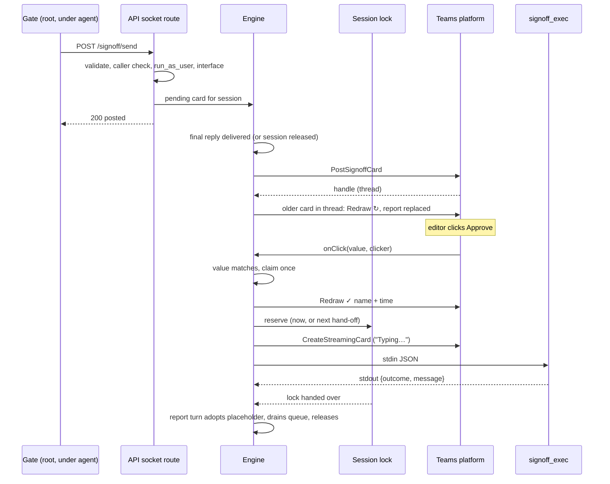
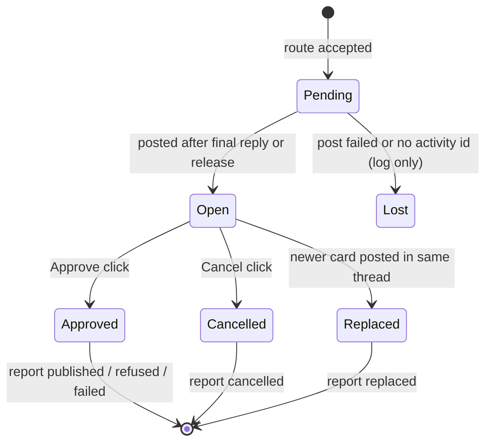
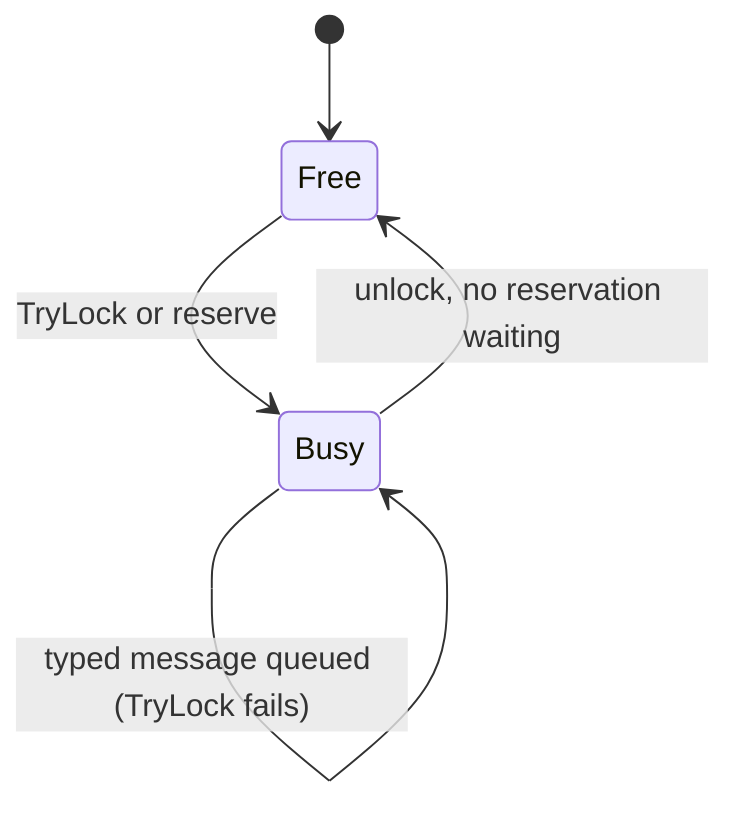

# Signoff Cards - Plan

## Goal Capsule

- **Objective:** An editor's click on a card in the Teams thread is the only thing that lets the content bot's publish command run; nothing the agent types, writes or runs can press that button, and the agent learns the result only afterwards.
- **Means:** a root-only socket route posts a card built from plain styled lines; the Teams handler consumes the click; cc-connect runs the project's `signoff_exec` and hands the agent a fixed-text report on a session held from the click (KTD1, KTD4, KTD7, KTD9).
- **Authority:** the origin brief (`docs/brainstorms/2022-requirements.md`) wins on product behavior and its tripwire list; KTDs win on mechanism; units override neither. Choices the brief did not dictate are logged under `## Plan` in `docs/brainstorms/signoff-cards-decisions.md`.
- **Stop conditions:** stop and ask (decisions file, `## Open questions`) when a choice would cross a tripwire: the route's fields, the `body` format, `signoff_exec` stdin/stdout, the button value, where the click is handled, the outcome report, a dropped outcome turn, anything run as root on an agent-writable path.
- **Execution profile:** one pull request into `downstream`, squash-merged (`DOWNSTREAM.md`, "Branches"). The branch rebases onto PR #8 (`taras/runas-agent-files`) once that merges. Code-first with unit tests per unit; a manual Teams check of the drawn card closes U6.
- **Who finishes:** the build pipeline implements, reviews and opens the PR; the upstream PR is posted by hand later.

---

## Product Contract

### Summary

cc-connect gains `POST /signoff/send` on its root-only API socket. A caller under the session's agent asks for a card (title, styled plain lines, two button labels); cc-connect posts it under the turn's final reply in that session's Teams thread. A click on Approve runs the project's `signoff_exec` with the clicker on stdin; Cancel voids the card; a newer card in the thread voids older ones. Every outcome reaches the agent as a fixed-text report turn, and after a click the session is held until that turn ends.

### Problem Frame

The content bot's agent runs as the user `claude`; cc-connect runs as root in the same pod. ch#2022 needs publication to wait for the editor's confirmation, and ch#2023 needs that limit to hold when the agent itself is prompt-injected. The gate in ch-content-bot builds the summary and owns the push; this unit supplies the card, the click and what the agent hears afterwards (see origin: `docs/brainstorms/2022-requirements.md`, "Acceptance criteria this unit serves").

### Requirements

**Route**

- R1. `POST /signoff/send` takes exactly `session_key`, `request_id`, `nonce`, `title`, `body`, `confirm_label`, `cancel_label`, and answers `posted` or a refusal with its reason (KTD2).
- R2. The route refuses a caller whose process parents do not reach that session's agent process (KTD3).
- R3. The route refuses a project without `run_as_user`.
- R4. The route refuses a platform that does not implement the signoff interface.
- R5. The route refuses a missing field, an empty `body`, or a line with a style outside the fixed set (KTD1, KTD2).
- R6. Every text in the request is shown as written, never read as markdown, HTML or any card format, and the format cannot express a button or an input (KTD1, KTD6).

**Card and posting**

- R7. The signoff card is a `core.Card`: header from `title`, one new plain styled element per `body` line, and the button row; cc-connect adds no words of its own (KTD1).
- R8. A new optional platform interface posts a signoff card and redraws it; Teams implements it and does not implement `CardSender`; the text fallback never carries a signoff card (KTD4).
- R9. A card requested during a turn is posted the moment that turn's final reply goes out, directly under it, in the turn code every turn runs through; the route answers `posted` before the platform has the card, and a failed post shows in the log only (KTD5).
- R10. The Approve button value is `signoff:<request_id>:<nonce>`; Cancel carries `signoff:<request_id>:<nonce>:cancel` (KTD2).

**Click**

- R11. A click counts only as a button press on that card, in the thread it was posted in, once, with the matching value; it is handled in the Teams handler before any message is built; open cards live in memory only (KTD4, KTD7).
- R12. No typed word and no earlier "Allow all" resolves a signoff card.
- R13. The click never reaches the agent as a message; the agent hears only the outcome report, after the command has answered.
- R14. Anyone in the thread may click (KTD7).
- R15. At the click, before anything runs, the card is redrawn once: buttons gone, a footer under a divider with a green ✓ or red ✕ in a narrow column, then the clicker's name and the date and time in the viewer's locale; no words, no outcome, no message of cc-connect's own (KTD6).
- R16. On Approve, cc-connect runs the project's `signoff_exec` with one JSON object on stdin and reads one JSON object from stdout; a non-zero exit, any other output, or the time limit gives outcome `failed` (KTD8).
- R17. On Cancel the card is void for good and `signoff_exec` does not run.
- R18. A newer card in a thread voids every older open card in that thread; when the newer card goes out, each older one is redrawn once with a grey ↻ and the time, and a click on it does nothing (KTD5, KTD6).

**Session hold and outcome report**

- R19. From the click until the outcome turn ends, the session is held: a "Typing…" placeholder appears under the card at the click and the outcome turn writes into it; a message typed meanwhile is queued with the queue notice and answered after the outcome (KTD9, KTD12).
- R20. After every outcome (`published`, `refused`, `cancelled`, `replaced`, `failed`) cc-connect starts a turn in the card's session with a fixed-text report naming the outcome and the command's `message` when there is one, never the nonce; that turn is never dropped because the session is busy (KTD10, KTD12).

### Acceptance Examples

- AE1. **Covers R2.** Given a process under another session's agent, when it posts a card naming this session, then the route refuses and nothing is posted.
- AE2. **Covers R9.** Given a card requested while a turn runs, when that turn's final reply goes out, then the card appears directly under it.
- AE3. **Covers R11, R16.** Given an open card, when Approve is clicked twice, then `signoff_exec` runs once.
- AE4. **Covers R11.** Given a card in thread A, when its button value is replayed from thread B, then nothing runs.
- AE5. **Covers R12.** Given an open card and an "Allow all" granted earlier, when the editor types "approve", "ok" or "确认", then the card stays open and nothing runs.
- AE6. **Covers R18.** Given an open card in thread A, when a newer card goes out in thread B, then the card in thread A stays open.
- AE7. **Covers R19.** Given a click on Approve while another turn still runs, when the editor types a message after the click, then the message gets the queue notice and is answered after the outcome turn.

### Scope Boundaries

- Hooks, the usage readout and attachment writes under `run_as_user`: PR #8 builds them. This plan stays out of PR #8's hunks in `core/message.go`, `agent/claudecode/session.go` and `CHANGES.md` (KTD11).
- The gate itself: summary, which pushes need a card, the count, the limit, the push, and how it learns `session_key` — all in ch-content-bot.
- Teams implementing `CardSender`; the signoff interface on any platform but Teams; a text-plus-buttons fallback for other platforms.
- A CLI command for the route (`cc-connect signoff send`): nothing calls it in this change.
- An `eyebrow` field or any field beyond the seven in R1.
- The upstream pull request itself; any commit on `main`.

#### Considered and not built

- A time cap on a card waiting for its turn (the proof of concept dropped it after 15 min). The card posts on the first of final reply or session release (KTD5), so it never waits past its turn. Evidence that would change it: a turn that never releases.
- Persisting open cards across a cc-connect restart. The brief requires memory only; after a restart a click on an old card is swallowed and does nothing, and the card keeps its buttons. Evidence that would change it: editors clicking stale cards in practice.
- Refusing the route when `signoff_exec` is unset. Approve then gives outcome `failed`, which the editor and the agent see at once.
- Retrying a failed redraw. A failed PUT leaves live-looking buttons whose click is a no-op; it is logged. Evidence that would change it: Teams throttling redraws in practice.
- Escaping markdown in the clicker's display name in the footer. The name comes from the tenant directory, not the agent or the gate; a markdown character in it is cosmetic.
- A cap on `signoff_exec` stdout size. The command is the root-only gate the operator configured.
- Moving a held report turn to the new active session the moment `/new`, `/cancel` or `/switch` runs. Until the report turn starts, a message typed on the new session can be answered first; the outcome still arrives. Evidence that would change it: editors resetting the session while a publish runs.
- Binding a click to the card's activity id through Teams' `replyToId`. The value plus conversation check (KTD7) already pins the card and thread; `activity` has no such field today (`platform/teams/activity.go:10-22`).

---

## Planning Contract

### Key Technical Decisions

- KTD1. **One new `core.Card` element, `CardText{Text, Style}`, with styles `heading`, `name`, `detail`, `link`.** Each `body` line becomes one `CardText`; the signoff card is `Header{Title}` + `CardText…` + one `CardActions` row. `CardMarkdown` needs escaping, which R6 forbids; `CardNote` draws as a footnote; list items and selects carry buttons. `RenderText` gets no case for it: a signoff card never goes through it (R8), and its switch skips elements it does not know (`core/card.go:237-268`). The engine's per-platform card copy (`core/engine.go:11783-11823`) passes unknown elements through untouched, so `CardText` is never rewritten. `link` is coloured text only: the format has nothing that clicks (R6).
- KTD2. **Strict request decode and the button values.** The route decodes with unknown fields refused, so no extra key (a button, an input, `eyebrow`, `project`) can ride along. Body lines are objects `{"style": "...", "text": "..."}` with non-empty text. `request_id` and `nonce` must be non-empty and free of `:`, because `signoff:<request_id>:<nonce>` is split on it; Cancel appends `:cancel`. Answer: `200 {"status":"posted"}`; refusals use the socket's plain-text `http.Error` (`core/api.go:205`): 400 malformed input, 403 caller check, 404 no live session for `session_key`, 422 project without `run_as_user` or platform without the interface.
- KTD3. **Caller check: socket peer pid, walked up through `/proc` to the session's agent pid; Linux only, fails closed elsewhere.** `http.Server.ConnContext` puts the `net.Conn` in the request context; `SO_PEERCRED` gives the peer pid; `/proc/<pid>/stat` gives each parent, depth-capped. The agent pid comes from a new optional `AgentProcessReporter{Pid() int}` on the agent session; Claude Code implements it in a new file of its package. Under `run_as_user` that pid is the root `sudo` wrapper (`core/runas.go:155-179`), and the caller (the root gate, started via sudo from the agent's shell) descends from it. The check sits in its own files behind injectable peer-pid and parent-pid functions on `APIServer`, called from the route through one function, so the route can go upstream without it. Engine resolution: the engines with a live session for `session_key` (through `interactiveKeyForSessionKey`, `core/engine.go:16467-16478`); when several match, the caller check picks the one whose agent is the caller's ancestor. The proof of concept's `core/peercred_linux.go` is the reference.
- KTD4. **Interface: `SignoffCardPlatform.PostSignoffCard(ctx, replyCtx, card, onClick) (SignoffCardHandle, error)`; the handle redraws the card with a mark and names the thread it was posted in.** This mirrors `StreamingCardPlatform.CreateStreamingCard` returning a `StreamingCard` (`core/interfaces.go:698-715`): post once, change in place later. The platform keeps what it needs to redraw and to route a click, in memory; core keeps the open-card state and decides. The click comes back through `onClick(value, clicker)`; core checks the value against the card's two button values (the nonce check lives in core, platform-neutral) and claims the card once, with the same claim the replacement uses, so only one of ✓, ✕ or ↻ is ever drawn. `onClick` returns after the claim and the redraw; everything after runs on its own goroutine, so the Teams dispatch slot is freed (`platform/teams/teams.go:30`). A post that yields no activity id is a failed post (`platform/teams/connector.go:133-141` treats the id as best-effort).
- KTD5. **Posting: a pending card waits on the engine for the first of two events, the turn's final reply or the session's release; with no turn holding the session it posts at once.** The final-reply hook sits right after the delivery block (`core/engine.go:5912`), before TTS, auto-compress and the queued continuation (`:5918-6106`). The release event is a new `Session.Released()` channel, closed whenever the holder lets go; reading it and checking busy happen under `Session.mu`, so a request that lands between the turn's last post and its unlock still posts (proof of concept, `core/gate.go` and `core/session.go` on `taras/gate-card-poc`). Pending and open cards live on the engine, keyed by session and by thread, never on `interactiveState`, which ~30 teardown paths discard. The card posts with the reply context of the turn that requested it, so it lands in the thread that turn answered. Replacement: post the newer card first; once that succeeds, claim and redraw ↻ every open card whose handle names the same thread, and start its `replaced` report.
- KTD6. **Teams draws request text as `TextRun`s in `RichTextBlock`s, never `TextBlock`.** Adaptive Card `TextBlock` text is markdown (`platform/teams/card.go:3-5`); `TextRun` is not. Title: large, bolder. `heading`: small, bolder, subtle, with a separator above. `name`: bolder. `detail`: small, subtle, no spacing. `link`: small, accent colour, no action. Buttons: `Action.Submit`, confirm with `style: positive`, `msteams.feedback.hide`, empty tooltip (proof of concept `platform/teams/gate.go`). Footer after a click or replacement: separator, `ColumnSet` with an auto-width column for the mark (✓ `Good`, ✕ `Attention`, ↻ subtle) and a stretch column with a small subtle `TextBlock` "`<name> · {{DATE(t, COMPACT)}}, {{TIME(t)}}`" (↻: date and time only), so Teams shows the viewer's locale and time zone. If Teams substitutes `{{DATE(`/`{{TIME(` inside a `TextRun` as well, the drawn text gets a zero-width word joiner (U+2060) between the two `{` of every `{{`, so it still looks exactly as written; the stored card keeps the text unchanged. Look: the mockups listed under Sources.
- KTD7. **The Teams click intercept sits in `dispatch` after the serviceURL checks and before the `allow_from` check and the message build (`platform/teams/webhook.go:123-181`).** Every action value starting `signoff:` is consumed there, card found or not, so none becomes an `IsPermissionResponse` message (`webhook.go:191-193`), where a stale `…:cancel` would read as the deny keyword "cancel" and the nonce would reach the agent. Teams finds the card by button value, checks the click's conversation id equals the card's, then calls `onClick` with the clicker's AAD object id (`userID(a)`, `webhook.go:554-559`) and display name. The intercept precedes `allow_from` because the brief lets anyone in the thread click; `allow_from` keeps governing who may talk to the bot. **Open:** whether a clicker outside `allow_from` reaches `onClick` waits on "Signoff click and `allow_from`" under `## Open questions` in the decisions file.
- KTD8. **`signoff_exec` runs as the supervisor through the project's shell and flag, without `shell_profile`, from `/`, in its own process group, on the engine's context, with a fixed 5 min limit.** `shell_profile` is prepended by the shared helper (`core/engine.go:7842-7845`) and may source files the agent's user can write, so the signoff command is built from shell and flag alone; working directory `/` keeps a root shell from resolving anything in `work_dir`. On the limit or when cc-connect stops, the whole process group is killed, so the gate's children cannot publish after cc-connect reported `failed`; a stop gives no report, and the gate's publish must therefore be all-or-nothing (a service stop kills the unit's processes anyway, `daemon/systemd.go:179-190`). `cmd.WaitDelay` of 2 s, as hooks set it (`core/hooks.go:180`), keeps a descendant that escaped the group and still holds a pipe from wedging the hold; the outcome is judged from the exit status and the stdout read by then. Stdin: `{"request_id", "nonce", "clicked_by": {"id", "name"}}`. Stdout must be exactly one JSON object with `outcome` in `published|refused` and an optional one-line `message`; unknown fields, a second value, a line break in `message` or any other text give `failed`. Stderr is logged. 5 min matches the webhook exec limit (`core/webhook.go:257`): a push plus its follow-up may outlast the cron default of 60 s, and a fixed limit adds no config key. The command runs at the click, without waiting for the hold.
- KTD9. **The hold starts at the click and ends when the report turn has drained its queue.** At the click core claims the card, redraws it, reserves the session (KTD12), cancels its idle close (`cancelAgentSessionIdleClose`, `core/engine.go:4293`), posts the placeholder through `StreamingCardPlatform.CreateStreamingCard`, and runs `signoff_exec` (Approve). When both the reservation and the outcome are in hand, the report turn runs through `processInteractiveMessageWith` on the reserved session, which releases it after draining queued messages (`core/engine.go:3707-3871`). If `/new`, `/cancel` or `/switch` replaced the active session meanwhile, the report turn lets the old one go and reserves the new active one. The placeholder reaches the turn on a new `Message.Placeholder` field that `processInteractiveEvents` adopts in place of creating its own streaming card (`core/engine.go:4830-4837`); a placeholder the report turn never reaches is finalized empty, with no words. `/ps` is refused while a hold has no turn in flight (`core/engine.go:6438-6444`), so injected text cannot become the report turn's result. Typed messages during the hold take the existing busy path (`queueMessageForBusySession`, `MsgMessageQueued`, `core/engine.go:3161-3229`).
- KTD10. **The report turn is a new path beside timers, sharing their resolution code.** It builds a synthetic message like `ExecuteTimerJob` (`core/engine.go:1771-1809`), with `UserMessageTimeMs` left 0 so the stale-queue watermark drops nothing, and reuses the timer's platform and workspace resolution, extracted into a helper both call with timer behavior unchanged. Where a timer gives up on a busy session (`:1835-1838`), the report turn reserves the session (KTD12). Report text, fixed English for the agent: `Signoff <request_id>: <outcome>`, `replaced` adds ` by <newer request_id>`, and a second line carries the command's `message` when non-empty. English, not i18n: it is a prompt to the agent, not a string a person reads. **Open:** the report's exact text waits on "Outcome report text" under `## Open questions` in the decisions file.
- KTD11. **Stay out of PR #8's hunks.** Claude Code's `Pid()` goes in a new file in `agent/claudecode/`; the `Message.Placeholder` field sits at the end of the `Message` struct (`core/message.go:363-402`), away from PR #8's hunks there (lines 1-10 and 155-310); the `CHANGES.md` entry is a new `#### Feature` block under `### Unreleased`; on the base that section is empty and PR #8 adds a `#### Fix` block at the same spot, so the rebase keeps both, Fix first. The route reads `run_as_user` through the existing `e.runAsUser()` (`core/engine.go:16614-16619`), already on the base; it does not depend on PR #8's code.
- KTD12. **Session reservation: a FIFO hand-off of the session lock.** `Session` gains a reservation that takes the lock at once when free, or queues the reserver so the next unlock hands the lock straight to it (busy stays true, no gap a typed message's `TryLock` could win). While a reservation waits, the queued continuation (`core/engine.go:5957`) and `drainPendingMessages` (`:6298-6325`) stop popping queued messages and let go, so messages typed after the click wait until the report turn has run. A plain 20 ms poll (`waitForSessionLock`, `:2771`) loses to typed messages and to the running turn's drain; the proof of concept's `Released()`-then-`TryLock` has the same gap. Every report turn reserves, click or replacement, so none is dropped and they run in the order their outcomes arrived.

### High-Level Technical Design

Sequence from request to report:

Card lifecycle in core:

Session lock with reservation:

### Assumptions

- The gate starts under the agent's process tree (the agent's shell runs it via sudo), so its ancestry reaches the agent's `sudo` wrapper; a gate launched any other way is refused by design.
- The gate learns `session_key` on its own side; under `run_as_user` the engine's `CC_SESSION_KEY` reaches the agent only when `run_as_env` lists it (`core/runas.go:102-108`, `core/engine.go:4059-4076`). U7 documents that.
- A Teams `TextRun` shows `{{DATE(...)}}` and markdown characters as written; U6's manual Teams check confirms it.
- 5 min is enough for the gate's publish command; the gate reads the limit from this repo.
- The gate runs from the thread's own turns. A gate started inside a cron or timer job that runs in a new session per run is refused: that turn's agent is a side session (`core/engine.go:1621-1625`, `:1822-1826`) the route does not resolve. U7 documents it.
- A click in a channel thread arrives with the same conversation id (`…;messageid=<root>`) the card was posted to; U6's manual click check confirms it, since the proof of concept matched clicks by request id only.

### Sequencing

U1 first. U2 and U8 next, in parallel. U3 after U1 and U2. U4 after U3 and U8. U5 after U4. U6 after U1 and U5. U7 last. One PR.

---

## Implementation Units

### U1. Plain styled text element and the signoff card model

- **Goal:** `core.CardText` exists and core can build a signoff card from a validated request.
- **Requirements:** R5, R6, R7, R10.
- **Dependencies:** none.
- **Files:** `core/card.go`, `core/card_test.go`, `core/signoff.go` (new), `core/signoff_test.go` (new).
- **Approach:**
  1. Add `CardText{Text, Style}` and the four style constants (KTD1).
  2. In `core/signoff.go`, add the request line type, style validation, and the card builder: header, one `CardText` per line, one `CardActions` with a primary confirm and a default cancel button carrying the values of KTD2.
- **Patterns to follow:** existing elements and marker methods in `core/card.go:28-76`; `PrimaryBtn`/`DefaultBtn` (`core/card.go:96-113`).
- **Test scenarios:**
  - The sample card from the brief builds a card whose header is "5 changes", whose 14 `CardText` elements keep order, style and text, and whose buttons carry `signoff:r1:n1` and `signoff:r1:n1:cancel`.
  - A line with style `bold` is refused; an empty `body` is refused; a line with empty text is refused.
  - Text holding `**x**`, `<b>x</b>`, `{"type":"AdaptiveCard"}` and `[a](b)` is kept byte for byte in the element.
- **Verification:** core builds; tests prove the card struct, not JSON.

### U2. Caller check: peer pid and agent ancestry

- **Goal:** the route can tell whether the socket caller descends from a session's agent process.
- **Requirements:** R2.
- **Dependencies:** none.
- **Files:** `core/peercred_linux.go` (new), `core/peercred_other.go` (new), `core/peercred_linux_test.go` (new), `core/peercred_test.go` (new), `core/interfaces.go`, `agent/claudecode/session_pid.go` (new), `agent/claudecode/session_pid_test.go` (new).
- **Approach:**
  1. Linux: peer pid via `SO_PEERCRED`, parent pid via `/proc/<pid>/stat` (parse after the last `)`); other systems return an error so the check fails closed (KTD3).
  2. A platform-neutral ancestry walk with a depth cap, taking the parent function as a parameter.
  3. Add `AgentProcessReporter` to `core/interfaces.go`; Claude Code's session returns its command's pid, 0 when none.
  4. Engine helper: the live agent pid for a session key through `interactiveKeyForSessionKey`.
- **Patterns to follow:** anonymous capability probes on `state.agentSession` (`core/engine.go:5598`); proof of concept `core/peercred_linux.go` on `origin/taras/gate-card-poc`.
- **Test scenarios:**
  - Ancestry walk with an injected parent function: 300 → 200 → 100 reaches agent 100; 300 → 200 → 1 does not; a parent lookup error fails closed; an agent pid of 0 fails closed; a cycle stops at the depth cap.
  - On Linux, a real unix socket pair returns the test process's own pid (build-tagged test; the seam misses nothing the route relies on beyond the syscall).
  - Claude Code's `Pid()` returns the started process's pid and 0 before start.
- **Verification:** `go test ./core/ -run PeerCred` and `go test ./agent/claudecode/ -run Pid` pass; `go build ./...` passes with `GOOS=darwin` and `GOOS=windows`.

### U8. Session reservation and release signal

- **Goal:** a session lock can be handed straight to a waiting reserver, and anyone can wait for the holder to let go.
- **Requirements:** R9, R19, R20.
- **Dependencies:** none.
- **Files:** `core/session.go`, `core/session_test.go`, `core/engine.go`.
- **Approach:**
  1. `Session.Released()`: a channel closed at the holder's next unlock, already closed when free; busy check and channel under `Session.mu` (KTD5).
  2. `Session` reservation (KTD12): take the lock when free, else queue; `unlock` hands the lock to the first reserver and keeps busy true; a query tells whether a reservation waits.
  3. In the queued continuation (`core/engine.go:5957`) and `drainPendingMessages` (`:6298`), stop popping queued messages while a reservation waits, and unlock.
- **Patterns to follow:** existing `TryLock`/`unlock` (`core/session.go:52-85`); the drain's atomic unlock under `state.mu` (`core/engine.go:6298-6305`).
- **Test scenarios:**
  - Reserve on a free session holds it at once; `TryLock` then fails.
  - Reserve on a busy session waits; `Unlock` hands over without a moment where `TryLock` succeeds; two reservers get the lock in order.
  - `Released()` on a free session is closed; on a busy one it closes at the unlock, also when the unlock hands the lock over.
  - Engine: with a reservation waiting, a running turn with queued messages finishes its own reply, does not start the queued turn, and hands the lock over; the queued message runs after the reserver releases.
  - Without a reservation, queued continuation and drain behave as today (existing tests stay green).
- **Verification:** `go test ./core/ -run 'Session|Signoff' -race` passes, and the existing queue tests pass unchanged.

### U3. The route `POST /signoff/send`

- **Goal:** the socket accepts or refuses a card request and hands an accepted card to the engine.
- **Requirements:** R1, R2, R3, R4, R5, R9 (answer before post).
- **Dependencies:** U1, U2.
- **Files:** `core/api.go`, `core/api_signoff_test.go` (new), `core/signoff.go`, `core/interfaces.go`.
- **Approach:**
  1. Set `ConnContext` on the server (`core/api.go:175`) and register the route in the block at `core/api.go:92-108`.
  2. Declare `SignoffCardPlatform` and its handle in `core/interfaces.go` (KTD4) and the engine's accept entry point (validated card, session key) in `core/signoff.go`; U4 fills in what accept does.
  3. Handler order: method guard, strict decode and validation (KTD2), engines with a live session for `session_key` (404 when none), caller check picking the engine (403), `e.runAsUser()` non-empty (422), the session's platform implements `SignoffCardPlatform` (422), then call accept and answer `posted`.
  4. The caller check is a function value on `APIServer`, defaulting to the U2 check, so tests inject it (KTD3).
- **Patterns to follow:** `handleSend` (`core/api.go:203-284`); API tests build `&APIServer{engines: …}` and call the handler (`core/api_test.go:15-44`).
- **Test scenarios:**
  - Covers AE1. Caller check reports "not under this session's agent": 403, nothing handed over.
  - A caller under the session's agent with a valid body: 200 `{"status":"posted"}`, one card handed to the engine.
  - Two engines with a live session under the same key: the one whose agent is the caller's ancestor gets the card.
  - Agent without `GetRunAsUser` or with it empty: 422, nothing handed over.
  - Platform stub without `SignoffCardPlatform`: 422.
  - Missing `nonce`, empty `body`, style `bold`, `request_id` with `:`, an unknown top-level field `eyebrow`: each 400.
  - `session_key` with no live session in any engine: 404.
  - GET: 405.
- **Verification:** `go test ./core/ -run Signoff` passes.

### U4. Posting under the final reply, and replacement

- **Goal:** pending cards post right under the turn's final reply or at release; a newer card voids the open cards of its thread.
- **Requirements:** R8, R9, R18.
- **Dependencies:** U3, U8.
- **Files:** `core/signoff.go`, `core/engine.go`, `core/interfaces.go`, `core/signoff_test.go`.
- **Approach:**
  1. Add the mark (approved, cancelled, replaced; clicker name; time) and the clicker (`id`, `name`) to `core/interfaces.go` beside the interface U3 declared (KTD4).
  2. Engine state, mutex-guarded: pending cards per `*Session`, open cards by thread; each card has one claim used by post, click and replacement.
  3. Accept: capture the turn's reply context and session; if `Released()` is already closed, post now, else post on the first of the final-reply hook and `Released()` (KTD5).
  4. Final-reply hook right after the delivery block (`core/engine.go:5912`).
  5. Post: through the interface; on success (non-empty handle), claim and redraw ↻ the other open cards in the same thread and hand each to a replaced-outcome hook that U5 connects to the report turn; on failure log with session and request id.
- **Patterns to follow:** stub platforms in `core/engine_test.go:288-349`; state injection (`core/engine_test.go:722-727`); proof of concept `holdGateCard`/`postHeldGateCards` on `taras/gate-card-poc`.
- **Test scenarios:**
  - Covers AE2. A card handed over during a turn posts after the stub platform received the turn's final reply and before the next queued message's reply.
  - A card handed over on an idle session posts at once.
  - A card handed over after the turn's final-reply hook ran but before the unlock posts at the unlock.
  - A turn that ends with no final reply posts its pending card at the unlock.
  - Two cards handed over in one turn: both post; the first is redrawn ↻ and reaches the replaced-outcome hook with the newer card's id.
  - A post that fails leaves the older open card open and calls no replaced-outcome hook.
  - Covers AE6. An open card in thread A and a newer one in thread B: A stays open.
  - Clearing the session's interactive state (as `/new` does) leaves the open card clickable.
- **Verification:** `go test ./core/ -run Signoff -race` passes.

### U5. Click, hold, `signoff_exec`, outcome report

- **Goal:** a click resolves the card once, holds the session, runs the command on Approve, and reports every outcome to the agent.
- **Requirements:** R11, R12, R13, R15, R16, R17, R19, R20.
- **Dependencies:** U4.
- **Files:** `core/signoff.go`, `core/signoff_exec.go` (new), `core/signoff_exec_unix.go` (new), `core/signoff_exec_windows.go` (new), `core/signoff_exec_test.go` (new), `core/engine.go`, `core/message.go`, `config/config.go`, `config/config_test.go`, `cmd/cc-connect/main.go`, `core/signoff_test.go`.
- **Approach:**
  1. Config: `signoff_exec` on `ProjectConfig` with a doc comment; `engine.SetSignoffExec` wired once at startup beside `SetShell` (`cmd/cc-connect/main.go:571`), which config reload does not touch either.
  2. `onClick(value, clicker)`: value must equal the card's confirm or cancel value; claim the card; redraw ✓/✕; return; the rest on a goroutine (KTD4).
  3. Hold (KTD9): reserve the active session, cancel its idle close, create the placeholder, and on Approve run the command at once.
  4. Runner (KTD8): shell and flag without profile, cwd `/`, engine context, 5 min, process group set and killed on the limit or stop (unix file; the Windows file kills the process), `WaitDelay` 2 s, strict stdout parse.
  5. Report turn (KTD10): extract `ExecuteTimerJob`'s platform and workspace resolution (`core/engine.go:1781-1809`) into a helper; build the synthetic message with the card's reply context, the report text and the placeholder; if the active session changed, release the reserved one and reserve the new one; run `processInteractiveMessageWith`. U4's replaced-outcome hook starts the same path without a placeholder.
  6. `Message.Placeholder`: `processInteractiveEvents` adopts it instead of creating a streaming card (`core/engine.go:4830-4837`), for the turn's first card only; any exit before the report turn reaches it finalizes it empty.
  7. `cmdPs` refuses while a hold has no turn in flight.
- **Execution note:** write the runner's tests against small shell scripts first; they pin the contract the gate reads.
- **Patterns to follow:** cron shell timeout (`core/engine.go:2040-2061`, `:8084-8089`); `ExecuteTimerJob` (`core/engine.go:1664-1846`).
- **Test scenarios:**
  - Approve with the right value: redraw ✓ with the clicker's name before the command starts; the command sees `{"request_id":"r1","nonce":"n1","clicked_by":{"id":"aad-1","name":"Lovely Editor"}}`; it prints `{"outcome":"published","message":"5 changes live"}`; the report turn's content is `Signoff r1: published` and `5 changes live`.
  - Covers AE3. A second click with the same value: no second run, no second redraw.
  - A click whose value carries a wrong nonce: nothing runs, card stays open.
  - A click on a card that was replaced: nothing runs.
  - Covers AE5. With the card open and `approveAll` set, typed "approve", "ok", "allow all" and "确认" leave the card open; the command never runs.
  - Cancel: redraw ✕, command not run, report `Signoff r1: cancelled`.
  - The command exits 1; prints `ok`; prints two JSON objects; prints `{"outcome":"done"}`; prints a `message` with a line break; sleeps past the limit (limit injected short in the test) with a child that would write a file after the limit, which must not appear: each gives `failed`.
  - The command prints valid JSON and exits 0 while a `setsid` child keeps stderr open: its outcome still arrives and the report turn runs.
  - `shell_profile` set to a script that writes a marker file: the marker never appears after Approve.
  - `signoff_exec` unset: Approve gives `failed`.
  - Covers AE7. Click while another turn runs; a message typed after the click gets `MsgMessageQueued`; the report turn runs before it.
  - Two cards in one turn: the first's report reads `Signoff r1: replaced by r2`.
  - The report turn for `replaced` starts while the session is busy: it runs after that turn, not dropped.
  - `/new` between the click and the report turn: the report turn runs on the new active session, and no two turns run at once.
  - `/ps` during the hold before the report turn: refused.
  - The report turn's content never contains the nonce.
  - The placeholder created at the click is the card the report turn finalizes; no second streaming card is created; an engine stop before the report turn finalizes it empty.
- **Verification:** `go test ./core/ -run Signoff -race` and `go test ./config/ -run Signoff` pass.

### U6. Teams draws, redraws and routes clicks

- **Goal:** Teams implements `SignoffCardPlatform` with the proof of concept's look, and consumes every `signoff:` click before a message is built.
- **Requirements:** R6, R8, R11, R13, R14, R15, R18.
- **Dependencies:** U1, U3 (interface), U4 (mark), U5 (click contract).
- **Files:** `platform/teams/signoff.go` (new), `platform/teams/signoff_test.go` (new), `platform/teams/webhook.go`, `platform/teams/teams.go`.
- **Approach:**
  1. Map a signoff `core.Card` to an Adaptive Card per KTD6; post with `conn.send` so the activity id is kept (`platform/teams/connector.go:98-105`); no id is an error.
  2. Keep posted cards in memory keyed by button value (both values point at one entry), with conversation id, reply context, activity id and the card. The handle's thread is the conversation id; its redraw rebuilds the body with the footer, drops the actions, PUTs it with `conn.update` (`connector.go:122-131`) and removes the entry.
  3. In `dispatch`, after the serviceURL checks and before the `allow_from` check (`webhook.go:132-153`), consume any `signoff:` action (KTD7): unknown value or another conversation → log and return; else call `onClick` with `userID(a)` and `a.From.Name`.
  4. Add the interface assertion beside the others (`teams.go:56-62`); no `CardSender`.
- **Patterns to follow:** `fakeSender` (`platform/teams/reply_test.go:8-76`); dispatch tests with `mustJSON(activity{… Value: …})` (`platform/teams/session_test.go:277-299`).
- **Test scenarios:**
  - The sample card renders the title as a large bolder `TextRun`, every line as a `TextRun` with its style's attributes, no `TextBlock` holding request text, two `Action.Submit` with feedback hidden, confirm `positive`.
  - Markdown, HTML and `{{DATE(...)}}` in a line stay byte for byte in the `TextRun` text.
  - Redraw ✓: actions gone, footer `ColumnSet` with ✓ in `Good` and "Lovely Editor · {{DATE(…, COMPACT)}}, {{TIME(…)}}"; ✕ in `Attention`; ↻ with date and time only.
  - A post whose connector returns no id is an error and keeps no entry.
  - A `signoff:` click from the card's conversation calls `onClick` once with AAD id and name; the handler never receives a message.
  - Covers AE4. The same value from another conversation: `onClick` not called, no message.
  - With `allow_from` set, a click from a thread member not on the list still calls `onClick`; a typed message from that member is still ignored.
  - An unknown `signoff:…:cancel` value (as after a restart): no `onClick`, no message, so a pending tool permission is not denied.
  - `perm:allow` still becomes a permission message (unchanged path).
  - `Platform` does not implement `core.CardSender`.
- **Execution note:** after the unit tests, post the sample card to a Teams test channel once and confirm a `TextRun` shows markdown and `{{DATE(...)}}` as written; if Teams substitutes `{{DATE(`/`{{TIME(`, add the word joiner of KTD6 and log it under `## Build` in the decisions file; build the joiner only then.
- **Verification:** `go test ./platform/teams/ -run Signoff` passes; the manual Teams check matches the mockups.

### U7. Documentation and changelog

- **Goal:** operators and the gate's author find the route, `signoff_exec` and the card where the repo documents config keys and Teams.
- **Requirements:** R1, R16 (contracts documented).
- **Dependencies:** U3, U5, U6.
- **Files:** `config.example.toml`, `docs/teams.md`, `CHANGES.md`.
- **Approach:**
  1. `config.example.toml`: commented `signoff_exec` in the `[[projects]]` example with the stdin/stdout contract, the 5 min limit, that a stop or the limit kills the command (so its publish must be all-or-nothing), the route's request, answers and refusal codes, the refusal of gates started from new-session cron or timer runs, and the `run_as_env` note for `CC_SESSION_KEY`, bilingual EN/ZH like its neighbours. No doc in `docs/` lists the socket routes today; `docs/usage.md` is a PR #8 file.
  2. `docs/teams.md`: a "Signoff cards" section: the card's look, who may click, what the click shows, replacement.
  3. `CHANGES.md`: a `#### Feature` heading under `## v1.5.0` → `### Unreleased` with one line `- **core**: … (upstream: pending)`; at the rebase onto PR #8 it goes after PR #8's `#### Fix` block.
- **Test expectation:** none -- documentation only.
- **Verification:** the docs name every field, style, `clicked_by` key, outcome, refusal code and the time limit exactly as the code does.

---

## Verification Contract

| Gate | Command | When |
|---|---|---|
| Build | `go build ./...` | every unit |
| Cross-build | `GOOS=darwin go build ./...`, `GOOS=windows go build ./...` | U2, U5 |
| Unit tests | `go test ./core/ -run 'Signoff|CardText|PeerCred|Session'`, `go test ./platform/teams/ -run Signoff`, `go test ./agent/claudecode/ -run Pid`, `go test ./config/ -run Signoff` | per unit |
| Race | `go test -race ./core/ -run 'Signoff|Session'` | U4, U5, U8 |
| Vet | `go vet ./core/ ./platform/teams/ ./agent/claudecode/ ./config/` | before review |
| Full suite | `go test ./...` | before each commit (`CLAUDE.md`), and in CI |
| Core stays neutral | grep `core/*.go` for platform names | before review (`CLAUDE.md`, pre-commit checklist) |
| Manual | sample card posted in a Teams test channel, clicked ✓ and ✕, replaced | U6 |

---

## Definition of Done

- Every R1-R20 has a passing test named in U1-U8, and every case in the brief's "Cases, each with its own test" has one.
- `core/` names no platform; Teams does not implement `CardSender`.
- No hunk overlaps PR #8's hunks in `core/message.go` or `agent/claudecode/session.go`; the `CHANGES.md` block sits next to PR #8's and is settled at the rebase (KTD11); the branch rebases onto PR #8 once it merges.
- Docs match code for: the seven fields, the four styles, the button values, `clicked_by.id` and `clicked_by.name`, the five outcomes, the report text, the 5 min limit, the answer and refusal codes.
- Every choice not dictated by the brief or this plan is logged under `## Build` in `docs/brainstorms/signoff-cards-decisions.md`.
- No dead-end or experimental code from abandoned approaches is left in the diff.

---

## Sources

- Origin brief: `docs/brainstorms/2022-requirements.md`.
- Proof of concept (reference, not the design): `core/gate.go`, `core/peercred_linux.go`, `core/session.go`, `platform/teams/gate.go` on `origin/taras/gate-card-poc`; its commits record that `Action.Execute` does not hide Teams' feedback note and that a click arrives as a `message` activity.
- PR #8: `origin/taras/runas-agent-files` (hunks in `core/message.go`, `agent/claudecode/session.go`, `CHANGES.md`, `core/runas.go`, `docs/usage.md`).
- Mockups (machine-local, best effort, not committed; a missing mockup is not a blocker and this plan governs any disagreement): `/Users/taras/Projects/ls/cc-connect/.claude/worktrees/signoff-cards/sandbox/claude/tv-build/signoff-cards-mockups/card-content.html`, `card-clickline.html`, `card-replaced.html`.
