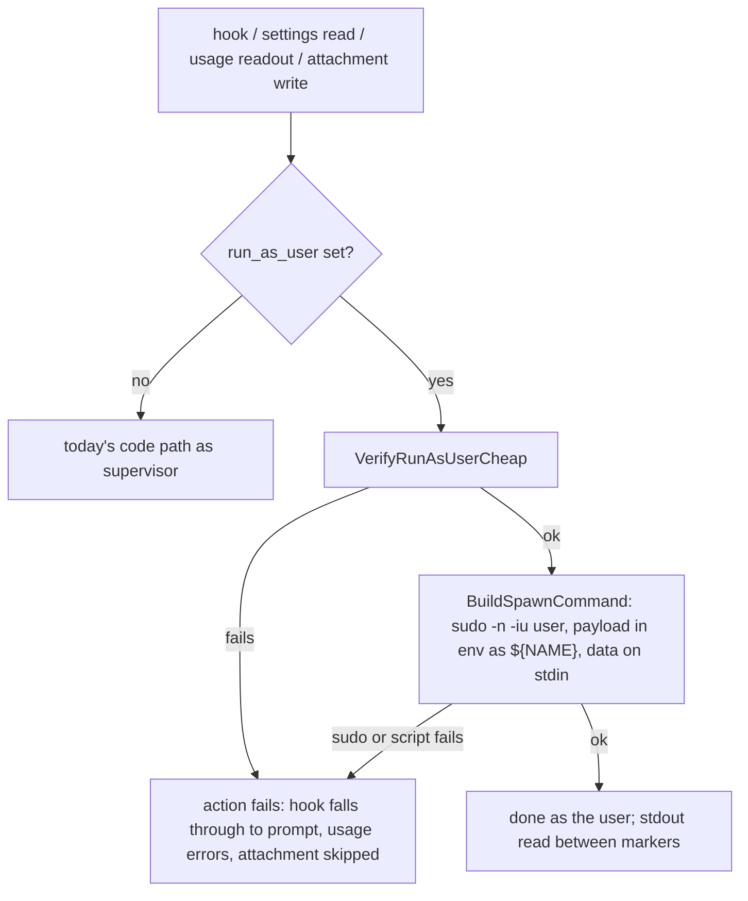

# run_as_user covers hooks, usage readout and attachments - Plan

## Goal Capsule

- **Objective:** On a project with `run_as_user`, an agent that plants files in folders it can write gets nothing run, read or written as root from them: settings hooks, the usage readout and inbound attachments all act as the agent's user.
- **Means:** every one of the three actions goes through the spawn path the agent itself already uses, `sudo -n -iu <user>` built by `core.BuildSpawnCommand` after the per-spawn check, with payloads carried in env and stdin (KTD1, KTD2).
- **Authority:** the origin brief's acceptance criteria and tripwire list, then this plan's Requirements, then KTDs, then units. A better shape the code supports wins over a brief mechanism and is logged in `docs/brainstorms/runas-agent-files-decisions.md`.
- **Stop conditions:** stop and log under `## Open questions` in the decisions file if a change would touch a tripwire item outside the three actions, cross into the signoff unit, or change behaviour for projects without `run_as_user`.
- **Execution profile:** one PR into `downstream`, squash-merged (`DOWNSTREAM.md`, "Branches"). Written PR-ready for upstream: no downstream-only glue.
- **Finish:** the build pipeline implements, reviews and opens the PR; the upstream PR is posted by hand after merge.

---

## Product Contract

### Summary

When a project sets `run_as_user`, cc-connect runs Claude settings PermissionRequest hooks, reads the settings files that define them, runs the usage-readout `claude` process, and writes inbound images and files, all as the agent's user via sudo. A failed sudo fails the action; nothing falls back to root. Projects without `run_as_user`, and every other agent, keep today's code paths.

### Problem Frame

The content bot runs its agent as `claude` while cc-connect runs as root in the same pod, next to a root-only program that holds the only key that can push live content (see origin: docs/brainstorms/2022-requirements.md). Three cc-connect actions still touch agent-writable paths as root: settings hooks (`agent/claudecode/cc_hooks.go`), the usage probe (`agent/claudecode/claude_usage.go`) and attachment writes (`agent/claudecode/session.go` `Send`, `core/message.go` `SaveFilesToDisk`). Each is a way for a prompt-injected agent to reach root, and through it the key, bypassing the editor's confirmation (ch#2022) and the limit that must hold under prompt injection (ch#2023).

### Requirements

**Settings hooks**

- R1. With `run_as_user`, every PermissionRequest hook command runs as that user, with its text unchanged: multi-line commands, quotes and `$` reach `sh -c` as written.
- R2. With `run_as_user`, the settings files that define hooks, including `<workDir>/.claude/settings.json` and `settings.local.json`, are read as that user; cc-connect never opens them as root.

**Usage readout**

- R3. With `run_as_user`, the usage readout's `claude` process runs as that user, in a directory that user owns, with the probe's flags unchanged.

**Attachments**

- R4. With `run_as_user`, inbound images are written as that user.
- R5. With `run_as_user`, inbound files are written as that user.
- R6. With `run_as_user`, cc-connect creates no directory and writes no file under `<workDir>/.cc-connect` as root, so a symlink planted as `.cc-connect`, as `attachments`, as a message subfolder, or as a file name inside is never followed by a root write.

**Failure and compatibility**

- R7. With `run_as_user`, when sudo to the user fails or the per-spawn check fails, the action fails: a hook falls through to the platform permission prompt, the usage readout returns an error, an attachment is skipped and logged. None of them runs as the supervisor instead.
- R8. Without `run_as_user`, hooks, the usage readout, and image and file writes behave as today.
- R9. Agents other than Claude Code keep today's attachment behaviour.

**Docs and changelog**

- R10. `docs/usage.md`, section "Running agents as a different Unix user (`run_as_user`)", says which actions run as the target user, where hooks are read from, and that an `.cc-connect` dir left root-owned by an older version must be chowned to the target; `CHANGES.md` gets one `#### Fix` entry under `## v1.5.0` → `### Unreleased`.

### Key Decisions

- **Hooks keep running under `run_as_user`, as the agent's user.** Chosen over turning settings hooks off, which fails open on a config typo and covers one action of three (see origin). Governs R1, R2.
- **The fix stays inside cc-connect.** Chosen over moving the pod's volume mount, which needs a new path setting and covers one action of three (see origin). Governs R1–R6.

### Scope Boundaries

- Slash commands that touch the work dir as root (`/memory`, `/diff`, `/show`, `/shell`) stay as they are; they are disabled in the content bots and named as remaining work in the upstream PR (see origin).
- Session-file operations under the supervisor's `~/.claude/projects` (`ListSessions`, `GetSessionHistory`, `DeleteSession`, `ValidateSessionID` in `agent/claudecode/claudecode.go`, and `transcriptPath` in `agent/claudecode/session.go`) stay as they are. They are reached through `/list`, `/history`, `/delete`, session resume and a path string on hook stdin, not through the brief's three actions. Named as remaining work in the upstream PR alongside the slash commands.
- `CC_CONNECT_PERMISSION_HOOK_SKIP=1` on the agent spawn is dropped by `FilterEnvForSpawn` under `run_as_user`, so Claude may also run its own hooks. That predates this unit and is left as is.
- The card route `POST /signoff/send` and its click handling belong to another unit.
- Other agents' sessions keep today's behaviour; `run_as_user` exists for Claude Code only.
- The symlink case is hardened under `run_as_user` only; the plain path keeps today's writes (R8).
- Not built: a root-side symlink-safe writer (`O_NOFOLLOW`, `openat2`, chown after write) or a root chown of an old root-owned `.cc-connect`. Writing as the user makes a planted link reach only what the user can already write (KTD1), and a root chown in an agent-writable parent is itself a root action there.
- Not built: telling the chat user when an attachment write fails, or sending a failed image inline anyway. Today's log-and-skip stays; new user-facing text would need all five translations. Would change if root-owned leftovers (Risks) turn out common.

#### Deferred to Follow-Up Work

- The upstream PR to chenhg5/cc-connect, posted by hand after merge.

### Sources

- Origin brief: `docs/brainstorms/2022-requirements.md`.
- Spawn primitive and per-spawn check: `core/runas.go` (`BuildSpawnCommand`, `FilterEnvForSpawn`, `VerifyRunAsUserCheap`); Windows stubs in `core/runas_windows.go`.
- Agent spawn as the user, the pattern to mirror: `agent/claudecode/session.go` `newClaudeSession`.
- Script on stdin through `sudo -n -iu`: `core/runas_audit.go` isolation probe; tagged stdout lines: its `parseProbeOutput`.
- `WaitDelay` on a shell hook: `core/hooks.go` `executeCommand`.
- Supervisor-side `LookPath` skip under isolation: `agent/claudecode/claudecode.go` `New`.
- Target user's `~/.claude/settings.json` holds hooks under `run_as_user`: `docs/usage.md`, "Environment propagation" checklist.
- `sudo -i` joins argv into one `-c` string for the target's login shell, backslash-escaping every byte except alphanumerics, `_`, `-` and `$` (sudo `parse_args.c`): empty arguments vanish, newlines turn into line continuations, `$NAME` expands unquoted in the outer shell, `${NAME}` and stdin pass intact.

---

## Planning Contract

### Key Technical Decisions

- KTD1. **Each action is a process spawned as the user through `core.BuildSpawnCommand`, preceded by `core.VerifyRunAsUserCheap`.** This is the path the agent spawn already takes, it works when the supervisor is not root but only holds sudo to the target, and once a write or read runs as the user, a planted symlink reaches only what that user could reach anyway. The new spawns leave `cmd.Dir` unset, since `sudo -i` ignores it and a non-root supervisor may not be able to enter the work dir. Rejected: root-side `setuid`/`chown` or symlink-safe opens, which need root and still act as root.
- KTD2. **Variable payloads cross sudo in preserved env vars referenced as `"${NAME}"`, data crosses on stdin, and anything read back on stdout is framed by marker lines.** `sudo -i` rewrites argv (Sources), so a hook command, a destination path or an empty probe flag passed as argv arrives changed. Each spawn adds its payload variable names to a copy of `SpawnOptions.EnvAllowlist`; login-profile output on stdout is ignored outside the markers.
- KTD3. **The chdir wrapper in `BuildSpawnCommand` references `"${CC_RUNAS_CHDIR}"`.** Today's `"$CC_RUNAS_CHDIR"` expands unquoted in the target's login shell and splits a work dir that contains a space. The hook spawn is the only new spawn that sets `WorkDir` and uses the wrapper; the attachment write and the usage probe carry their dirs in their own scripts. The fix also corrects the agent spawn under `run_as_user`; the non-isolated path is untouched.
- KTD4. **Under `run_as_user`, hook settings come from the target user's config home, read in one spawn per session.** The script resolves `${CLAUDE_CONFIG_DIR:-${HOME}/.claude}` in the target's login environment, the dir Claude itself reads as that user and the one `docs/usage.md` tells operators to set up, and prints each existing file among `settings.json` and `settings.local.json` in that dir and in `<workDir>/.claude` between markers, with the work dir passed in a preserved env var. Rejected: the supervisor's `~/.claude`, which the target often cannot read and Claude-as-target never honours. In the content-bot pod both are the same volume.
- KTD5. **Hooks run as the user with the session work dir as cwd, and are cancelled with SIGTERM plus a `WaitDelay`.** sudo relays SIGTERM but cannot relay the SIGKILL `exec.CommandContext` sends, and without `WaitDelay` a surviving child holding stdout keeps `Wait` blocked past the 60s timeout. Without `run_as_user` the hook keeps today's cwd and cancel (R8).
- KTD6. **The usage probe runs in `${HOME}/.cc-connect/usage-probe` of the target, created by `mkdir -p` inside the same spawn, with the probe's flags written inside the spawned script.** One spawn, nothing to remove afterwards, one trust entry instead of one per run, and `--tools ""` survives because it never crosses sudo as argv. Rejected: a temp dir made and removed by extra spawns (three spawns, leaks on kill, a new trust entry per run) and a root `os.MkdirTemp` (0700, unusable by the target).
- KTD7. **Attachments use one write-as-user primitive in `core`, reached through a `SaveFilesToDisk` variant that takes `SpawnOptions`.** The primitive makes missing parent dirs and creates the file with noclobber from stdin, exiting with a distinct code when the name exists, so Go keeps choosing names and the numeric-suffix loop stays. `SaveFilesToDisk` keeps its signature and today's code for every other agent (R9); the Claude Code image write uses the primitive under `run_as_user`.
- KTD8. **Tests prove "as the user" with a fake `sudo` first on `PATH` that reproduces `sudo -i` argv handling.** `BuildSpawnCommand` and `ExecSudoRunner` resolve `sudo` through `PATH`. The shim records argv, refuses the nested `sudo -n /usr/bin/true` so the per-spawn check passes, exports a marker naming the `-iu` user, joins the command after `--` the way sudo does, and runs it with `/bin/sh -c`. A non-executing variant records only, for the symlink cases. No production seam is added; each test package carries its own copy of the shim.

### High-Level Technical Design

Each action under `run_as_user` follows the same gate. Without `run_as_user` the left branch is today's code, unchanged.

### Assumptions

- The `sudo -i` argv rewriting in Sources was established by reading sudo's source and simulating it in bash and dash, not on a real sudo host; the fake `sudo` reproduces it, and the implementer checks one hook, one write and the probe on a real host when one is at hand.
- `sudo` passes a piped stdin through (the agent spawn and the isolation probe rely on this) and a pty through for the usage probe; closing the ptmx sends SIGHUP, which sudo relays.
- One extra `sudo -i` login per attachment, one per session for settings, one per hook run and one per usage readout are acceptable; `VerifyRunAsUserCheap` caches for 30s.
- Under `run_as_user`, hooks and the probe get the allowlist plus the target's login env, as the agent does; a hook that needs provider keys gets them from the target's profile or `run_as_env`.
- The reply footer's usage text has a 1.5s budget (`core/engine.go` `replyFooterUsageTimeout`); a slower probe under `run_as_user` leaves the footer without usage, which is today's behaviour on any probe error.

### Risks

- **Root-owned leftovers.** Older versions created `<workDir>/.cc-connect` and `attachments` as root with mode 0755. After this change the target cannot write into them, and every attachment is skipped until someone chowns them. The skip is logged with the path; R10 documents the chown. The content bot's release must check its work dirs before raising the pin, using the link-safe `chown -hR` form if it fixes them.

---

## Implementation Units

### U1. Spawn plumbing and attachment writer in core

- **Goal:** `core` can create attachment dirs and new files as the `run_as_user` user, `SaveFilesToDisk` has a variant that uses it, and the chdir wrapper survives spaces.
- **Requirements:** R5, R6, R7, R9 (KTD1, KTD2, KTD3, KTD7).
- **Dependencies:** none.
- **Files:** `core/runas.go`, `core/runas_windows.go`, `core/message.go`, `core/runas_test.go`, `core/message_test.go`.
- **Approach:**
  1. Change the wrapper in `BuildSpawnCommand` to `"${CC_RUNAS_CHDIR}"` (KTD3) and update the comment that describes it.
  2. Add the write primitive next to `BuildSpawnCommand`: per-spawn check, then one spawn whose script makes the parent dirs and creates the destination with noclobber from stdin; destination path in a preserved env var. The script returns the "exists" code only when an explicit test of the destination (`-e` or `-L`) succeeds before the create, which Go maps to an error matching `fs.ErrExist`; every other failure (mkdir, open, write) exits with a generic code that Go maps to skip, so the suffix loop cannot spin on an unwritable dir.
  3. Add the `SaveFilesToDisk` variant taking `SpawnOptions`. Outside isolation it is `SaveFilesToDisk` unchanged. Inside isolation it calls no `os.MkdirAll`, `os.OpenFile`, `os.CreateTemp` or `os.Link`, and both the scoped and flat layouts use the primitive; the flat layout refuses an existing name, as today.
  4. Windows stubs: isolation is never on, so the variant is the plain path.
- **Patterns to follow:** `RunAsChdirEnv` + `mergedAllowlist` for preserved env; `writeUniqueNoOverwrite` suffix loop.
- **Test scenarios:**
  - With the executing fake `sudo` and a work dir containing a space, a command spawned with `WorkDir` runs in that dir.
  - With the executing fake `sudo`, the variant writes a binary file byte for byte, and the fake's log shows `-n -iu <user>`.
  - With the executing fake `sudo` and an existing `name.txt`, the second write lands as `name_1.txt`.
  - With the non-executing fake `sudo` and `<workDir>/.cc-connect` a symlink to an outside dir, the outside dir stays empty.
  - Same with `attachments` as the symlink, and with a symlink planted at the destination file name.
  - With a fake `sudo` that exits non-zero, the variant returns no paths and nothing appears on disk.
  - With the executing fake `sudo` and an `attachments` dir the test user cannot write (skipped when running as root), the variant returns no paths and returns promptly.
  - With empty `SpawnOptions`, existing `SaveFilesToDisk` tests pass and no `sudo` runs.
- **Seam:** the fake `sudo` catches whether the action goes through sudo for the right user, survives sudo's argv rewriting, and leaves the path alone in-process; it does not prove the kernel uid, which the real sudoers setup and `cc-connect doctor user-isolation` own.
- **Verification:** core tests above pass; the non-isolated tests are unchanged.

### U2. Claude Code attachments go through the user write

- **Goal:** `claudeSession.Send` writes images and files as the user under `run_as_user`.
- **Requirements:** R4, R5, R6, R8 (KTD7).
- **Dependencies:** U1.
- **Files:** `agent/claudecode/session.go`, `agent/claudecode/session_test.go`.
- **Approach:**
  1. Keep the session's `SpawnOptions` on `claudeSession`; `newClaudeSession` already receives them.
  2. Under isolation, skip the `os.MkdirAll` of the attachments dir and write each image with the U1 primitive. Outside isolation keep today's `os.MkdirAll` + `os.WriteFile`.
  3. Call the U1 `SaveFilesToDisk` variant with the session's options.
- **Patterns to follow:** image naming and `savedPaths` handling in `Send`.
- **Test scenarios:**
  - Under `run_as_user` with the executing fake `sudo`, an inbound image lands in `<workDir>/.cc-connect/attachments` and the fake's log names the user.
  - Under `run_as_user`, an inbound file lands under the message subfolder and the log names the user.
  - Under `run_as_user` with the non-executing fake `sudo` and `attachments` a symlink to an outside dir, the outside dir stays empty for both an image and a file.
  - Without `run_as_user`, image and file land where they do today and no `sudo` runs.
- **Verification:** the prompt still references the saved paths; tests above pass.

### U3. Settings hooks read and run as the user

- **Goal:** under `run_as_user`, hook settings are read and hook commands run as the user.
- **Requirements:** R1, R2, R7, R8 (KTD1, KTD2, KTD4, KTD5).
- **Dependencies:** U1 (wrapper fix).
- **Files:** `agent/claudecode/cc_hooks.go`, `agent/claudecode/session.go`, `agent/claudecode/cc_hooks_test.go`.
- **Approach:**
  1. Give the hook runner the session's `SpawnOptions` and work dir (built in `newClaudeSession`).
  2. Under isolation, load all four settings files (config home and `<workDir>/.claude`) with the one-spawn read (KTD4) and parse each framed file as `readSettingsFile` does; a missing file is absent, as today. Outside isolation, read from the supervisor's config home as today.
  3. Under isolation, run each hook as `sh -c` on the command taken from a preserved env var, through `BuildSpawnCommand` with `WorkDir` set to the session work dir, env from today's list minus the skip flag, then `FilterEnvForSpawn`, after `VerifyRunAsUserCheap`, with KTD5's cancel. Outside isolation, run it as today.
  4. A failed check, spawn or read is logged and treated like a failed hook today: next hook, then the platform prompt.
- **Patterns to follow:** spawn block in `newClaudeSession`; `TestTryHook` setup with `CLAUDE_CONFIG_DIR`.
- **Test scenarios:**
  - Covers the brief case "a settings hook command runs as the `run_as_user` user": with the executing fake `sudo` exporting the user marker, a hook that prints allow only when the marker names the target yields allow.
  - Covers the brief case for session-folder hooks: a hook defined only in `<workDir>/.claude/settings.json` yields allow through the fake `sudo`, and the same for `settings.local.json`; the fake's log shows both the settings read and the hook went through sudo.
  - A multi-line hook command containing single-quoted `$x` runs as written under the fake `sudo`.
  - Under `run_as_user`, the hook runs with cwd equal to the session work dir.
  - Under `run_as_user` with a fake `sudo` that exits non-zero, `tryHook` returns no decision and no hook command runs directly.
  - Under `run_as_user` with a hook that sleeps past a short context deadline, `tryHook` returns within the deadline plus the `WaitDelay`.
  - Under `run_as_user`, a missing settings file is skipped without error and the others still load; profile noise on stdout outside the markers is ignored.
  - Without `run_as_user`, existing `TestRunHookCommand` and `TestTryHook` cases pass unchanged and no `sudo` runs.
- **Verification:** hook decisions under isolation come only from commands run through sudo.

### U4. Usage readout runs as the user

- **Goal:** under `run_as_user`, the usage probe's `claude` runs as the user in the target's probe dir.
- **Requirements:** R3, R7, R8 (KTD1, KTD2, KTD6).
- **Dependencies:** none.
- **Files:** `agent/claudecode/claude_usage.go`, `agent/claudecode/claude_usage_test.go`.
- **Approach:**
  1. Under isolation, skip the supervisor-side `exec.LookPath("claude")`, as `New` already does.
  2. Run `VerifyRunAsUserCheap`, then start the probe in the pty through `BuildSpawnCommand`: a script that makes and enters the probe dir and execs `claude` with the probe flags, env from `FilterEnvForSpawn`.
  3. Outside isolation, keep today's `os.MkdirTemp`, `exec.CommandContext` and `os.RemoveAll`.
- **Patterns to follow:** `newClaudeSession` spawn block; `TestNew_RunAsUserSkipsClaudeLookPath`.
- **Test scenarios:**
  - Under `run_as_user` with a fake `sudo` that records and runs a stub `claude` on the shim's `PATH`, the stub sees `--tools ""` as an empty argument, `--permission-mode plan` and `--no-chrome`, and runs in `${HOME}/.cc-connect/usage-probe`.
  - Under `run_as_user` with no `claude` on the supervisor's `PATH`, `GetUsage` still reaches the sudo spawn.
  - Under `run_as_user` with a fake `sudo` that exits non-zero, `GetUsage` returns an error and no `claude` starts directly.
  - Without `run_as_user`, no `sudo` runs (the existing smoke test keeps its skip).
- **Verification:** no probe process or dir is created by the supervisor under isolation.

### U5. Docs and changelog

- **Goal:** operators can read which actions run as the target user.
- **Requirements:** R10.
- **Dependencies:** U1–U4.
- **Files:** `docs/usage.md`, `CHANGES.md`.
- **Approach:**
  1. In "Running agents as a different Unix user (`run_as_user`)", state that settings hooks (read from the target's config home and the work dir), the usage readout and inbound attachment writes run as the target user, that a failed sudo fails the action, and that a root-owned `<workDir>/.cc-connect` from an older version needs `chown -hR <target-user>`. Say that the `-h` form is required: the target can write the work dir and could replace `.cc-connect` with a symlink.
  2. Add one line under `## v1.5.0` → `### Unreleased` → `#### Fix`, after existing entries, in the form `- **claudecode**: <what changed> (upstream: pending)`. Never edit `CHANGELOG.md`.
- **Test expectation:** none -- documentation only.
- **Verification:** the docs section names all three actions and the chown step; the `CHANGES.md` entry is short and states what changed.

---

## Verification Contract

| Gate | Command | Applies to |
|---|---|---|
| Unit tests for touched files | `go test ./core/ -run 'RunAs|SaveFiles|BuildSpawn'` and `go test ./agent/claudecode/ -run 'Hook|Usage|Send|RunAs'` | U1–U4 |
| Full suite before each commit | `go test ./...` (`CLAUDE.md`) | all |
| Lint as CI runs it | `golangci-lint run --new-from-rev origin/downstream ./core/... ./agent/claudecode/...` (`.github/workflows/ci.yml`) | all |
| Build | `go build ./...` and `GOOS=windows go build ./...` | all |
| Core stays agnostic | no agent or platform name added in `core/*.go` (`CLAUDE.md` pre-commit checklist) | U1 |

Fake-`sudo` tests set `PATH`, so they do not run in parallel, call `core.ResetVerifyCache()`, and skip on Windows like the existing run-as tests.

---

## Definition of Done

- R1–R10 hold, each brief case has its own passing test, and `go test ./...` passes.
- Under isolation, no path calls `os.MkdirAll`, `os.WriteFile`, `os.OpenFile`, `os.ReadFile`, `exec.Command` or `pty.Start` on an agent-writable path as the supervisor.
- Projects without `run_as_user` run the same code they ran before for all three actions.
- `docs/usage.md` and `CHANGES.md` updated; `CHANGELOG.md` untouched.
- Decisions made while building are logged under `## Build` in `docs/brainstorms/runas-agent-files-decisions.md`.
- Abandoned-attempt code is removed from the diff.
