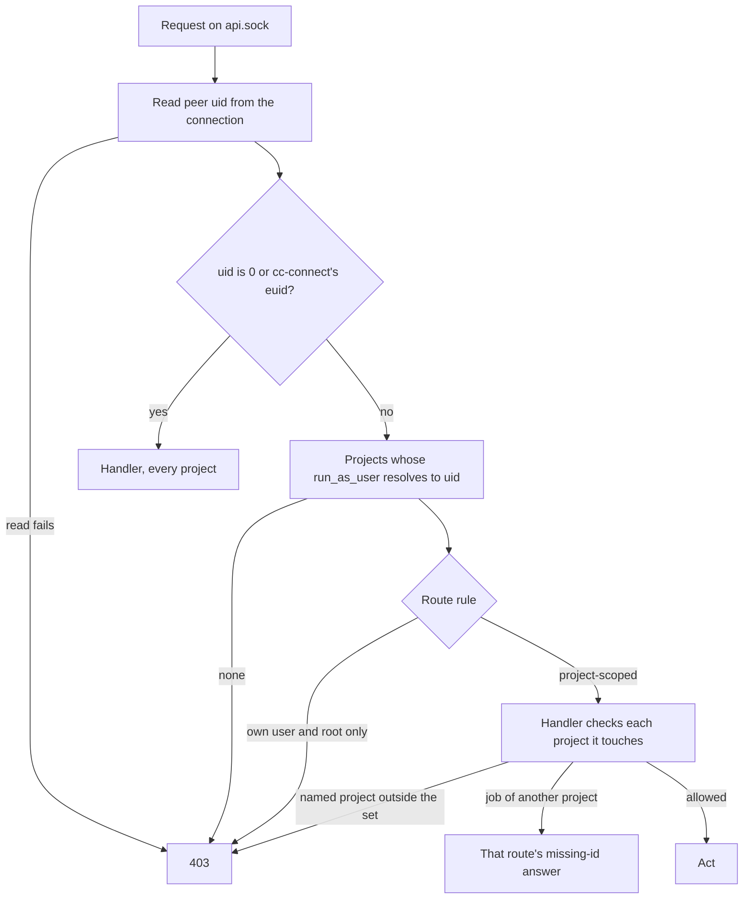
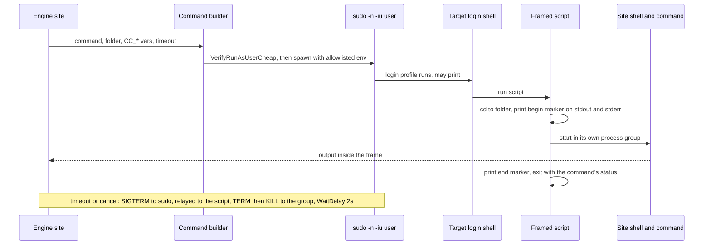
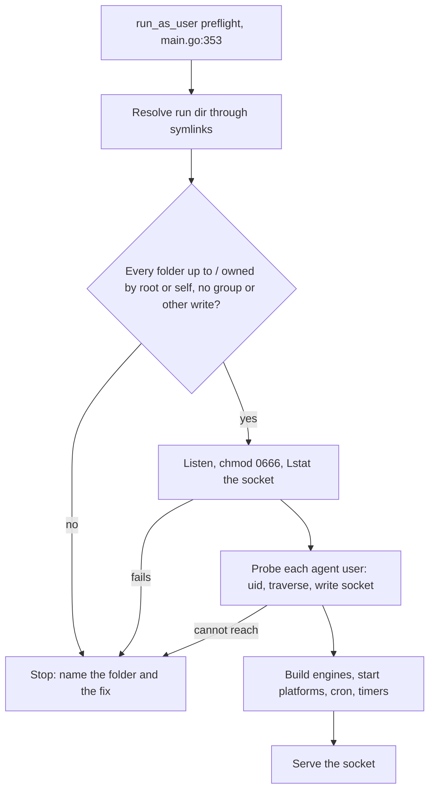

# run_as_user commands and API socket scope - Plan

## Goal Capsule

- **Objective:** When a project sets `run_as_user`, its agent can use cc-connect's API socket for its own project and for nothing else, and every command cc-connect runs for that project runs as the agent's user, so the agent cannot reach root or another project through the socket.
- **Why now:** the content bot's publish command, running as `claude`, must post a signoff card through `POST /signoff/send`, and Approve must run `signoff_exec` as `claude`, not as root (ch#2022: "The publication goes live only after the editor confirms the summary").
- **Means:** one core builder runs every project command through `sudo -n -iu` (KTD1); the socket checks the caller's uid from peer credentials against each route's rule on every request (KTD5, KTD6).
- **Authority:** the origin brief `docs/brainstorms/2022-requirements.md` (acceptance criterion, slice, tripwire list) > this plan's Product Contract > KTDs > unit text. Choices the brief does not dictate are logged in `docs/brainstorms/runas-commands-and-socket-decisions.md` (`## Plan` here, `## Build` during implementation).
- **Execution profile:** one pull request into `downstream`, squash-merged (`DOWNSTREAM.md`, "Branches"). Written PR-ready for upstream. The signoff parts (U4, U8) stay in their own commits so the upstream offer can leave them out.
- **Stop conditions:** stop and write under `## Open questions` in the decisions file when a choice would contradict the brief, touch the tripwire list in a way this plan does not already state, or cost work outside this unit.
- **Who finishes:** the build pipeline implements, reviews and opens the PR; a person offers it upstream by hand after merge (chenhg5/cc-connect#1527).

---

## Product Contract

### Summary

Every command cc-connect runs for a `run_as_user` project goes through one builder that wraps it in `sudo -n -iu <user>`, passes only an allowlisted environment, cuts the target's login-shell output away and still stops on timeout.
The API socket reads each caller's uid, lets cc-connect's own user and root do everything, and lets an agent's user act only for the projects that run as it.
With a `run_as_user` project the socket opens `0666` after a folder check, and any socket problem stops startup with a fix.
A real Linux test with several users proves the isolation end to end.

### Problem Frame

The socket is root-owned `0600`, so the bot's user cannot call `/signoff/send`, and `signoff_exec` runs as root.
Opening the socket alone would be worse: any route trusts the project named in the request, and cron `exec` added through the socket runs as root.
Upstream already closed chenhg5/cc-connect#1580 (a `chown`/group fix) over exactly these gaps and asked for peer credentials, non-root supervisor support, an actionable startup error and a real multi-user test (see origin: "Cross-cutting constraints").

### Requirements

**Commands run for a project**

- R1. Under `run_as_user`, each of these runs as the project's `run_as_user`: `signoff_exec`, cron `exec`, timer `exec`, custom-command `exec`, `/shell` and `!`, webhook `exec`, `[[hooks]]` commands, `/diff` (its git commands and `diff2html`), and the workspace clone.
- R2. A project without `run_as_user` keeps today's behaviour for every one of them, byte for byte.
- R3. A command run as the target gets only what `run_as_env` passes plus the `CC_*` variables a job needs to call the CLI back, never cc-connect's full environment.
- R4. What the target's login shell prints never reaches the chat or the command's captured output.
- R5. A command that times out or is cancelled still stops.
- R6. `signoff_exec` still reads the click on stdin and answers on stdout, unchanged.

**Who may use the socket**

- R7. On every request cc-connect reads the caller's uid from the socket's peer credentials. cc-connect's own user and root may act for every project, as today.
- R8. Any other caller may act only for projects whose `run_as_user` is that uid. Projects sharing a `run_as_user` share one scope. A caller that is no project's user is refused on every route.
- R9. Per route, for a scoped caller:
  - `/send`, `/cron/*`, `/timer/*`: only its projects. A job of another project answers as not found, with that route's missing-job answer. A cron edit may only name its projects.
  - `/relay/send`: only `from` one of its projects.
  - `/signoff/send`: one of its projects, then the existing check that the caller runs under that session's agent.
  - `/sessions`, `/relay/bind`, `/relay/binding`, and any route registered without a stated rule: refused.
- R10. On `/send`, `cron add` and `timer add` with no project named, a scoped caller with exactly one project defaults to it.

**The socket file and startup**

- R11. The socket stays `0600` while no project has `run_as_user`. With one, it becomes `0666` after cc-connect checked that no other user can write its folder or any folder above it. No `chown` anywhere.
- R12. On a platform without peer credentials the socket stays `0600`, every caller counts as cc-connect's own user, and a `run_as_user` project stops startup.
- R13. With a `run_as_user` project, a socket that cannot be opened or made safe, or an agent user that cannot reach it, stops startup with a message naming the fix.
- R14. Under `run_as_user` the agent receives `CC_DATA_DIR`, `CC_PROJECT` and `CC_SESSION_KEY`, and `cc-connect send` from the agent reaches the socket.
- R15. After a config reload every caller's scope is unchanged.

**Proof and docs**

- R16. A real Linux test with one user per project, one shared user, and one user that is no project's runs the matrix through the real CLI as each user, once with cc-connect as root and once as a non-root supervisor with the documented scoped sudo rule; a cron `exec` job records the user it ran as.
- R17. `docs/usage.md` ("Security guarantee and non-guarantee") says commands run as the target too and describes who may use the socket, its mode and the startup checks; `CHANGES.md` gets the new entries.

### Acceptance Examples

- AE1. Covers R8, R9. Given projects A (`run_as_user = agent_a`), B and C (`agent_b`), D (none): `agent_a` can `send`, `cron add`, `timer add` for A; for B each answers 403; `cron list` shows only A's jobs; `cron info/del/exec/run` of B's job answers exactly like a missing id; `agent_b` acts for B and C; `stranger` gets 403 everywhere.
- AE2. Covers R9. `agent_a` runs `cron edit <A's job> project B`: 403, and the job stays in A.
- AE3. Covers R9. On Linux, `agent_a` posts `/signoff/send` for a live session of B: 403. For its own session from under its agent: posted.
- AE4. Covers R10. `agent_a` runs `cc-connect send` with no project while A, B, C, D exist: it lands in A. `agent_b` does the same: "project is required".
- AE5. Covers R1, R2, R16. A cron `exec` job `id -un > <file>` in A writes `agent_a`; the same job in D writes cc-connect's own user.
- AE6. Covers R11, R13. With A configured and `data_dir` under a folder `agent_a` cannot traverse, startup stops and names that folder and the fix.

### Scope Boundaries

Out of scope, as the brief says (see origin: "What to leave alone"):

- The signoff route's refusal for a project without `run_as_user` (`core/api.go:831`) and the rest of the signoff route and card.
- Claude settings hooks, the usage readout and attachment writes (done in ls.4).
- ffmpeg, TTS, `doctor`, daemon management, self-restart: they stay cc-connect's own user.
- `disabled_commands` for socket callers.
- lovely-docker-agent's README, ch-content-bot, the upstream PR itself, and `main`.
- A `cc-connect signoff send` CLI command: the tripwire list names one, but none exists (`cmd/cc-connect/main.go:205-231`); this unit adds none.
- `/signoff/send`'s agent-pid check outside Linux: it reads `/proc` and keeps failing closed on macOS, as today (`core/peercred_other.go:10-17`).

Considered and not built:

- Killing a target's processes that left the command's process group. Today a timed-out command's grandchildren also survive (`core/engine.go:8100` kills the direct child only). Would change if the e2e shows a plain background child surviving.
- Tightening the modes of the files cc-connect keeps in `data_dir`. Every agent user must traverse `data_dir`, and the stores there are written `0644` under fixed names (`crons/jobs.json`, `relay_bindings.json`, `workspace_bindings.json`; `core/cron.go:149`, `core/relay.go:400`, `core/workspace_binding.go:211`), so another project's user can read them. Settled: this unit ships the documented limitation (U10). Reading a store gives no socket reach, since every route checks the caller's uid, and the consumer runs one project per cc-connect (see origin: "Accepted reach"). Would change if a deployment runs projects of different users that must not see each other's jobs or bindings.
- Recording which caller created a cron or timer job. Without it, a job an agent added runs as cc-connect's own user once `run_as_user` is removed; the docs say so. Would change if an operator needs to remove `run_as_user` on a live project with agent-made jobs.
- Narrowing the bot's reach to `send`, cron and timer further (see origin: "Accepted reach").

#### Deferred to Follow-Up Work

- Offering the change upstream without the signoff commits, referencing chenhg5/cc-connect#1527 (manual, after merge).
- Raising lovely-docker-agent's cc-connect pin, then ch-content-bot's publish command (release order, see origin).
- Widening CI's trigger to `downstream` so the new e2e job gates downstream PRs.

### Sources

- Origin brief: `docs/brainstorms/2022-requirements.md`.
- Decision log: `docs/brainstorms/runas-commands-and-socket-decisions.md`.
- Run-as primitive: `core/runas.go:160` (`BuildSpawnCommand`), `:255` (`FilterEnvForSpawn`), `:305` (`VerifyRunAsUserCheap`), `:209-249` (`WriteFileAsUser`, the cancel/WaitDelay pattern).
- Framed output and env-carried commands under `sudo -i`: `agent/claudecode/cc_hooks.go:20-56`, `:431-496`.
- Peer credentials and the request's connection: `core/peercred_linux.go:15-35`, `core/peercred.go:13-30`, `core/api.go:182-195`.
- Non-root supervisor rule: `docs/usage.md:406-409`.

---

## Planning Contract

### Key Technical Decisions

The brief named these mechanisms as preferences. Each was checked against the code; KTD1-KTD8 keep them, the rest pin what the brief left open. Smaller choices sit in the decisions file.

- KTD1. **One builder runs every project command as the target.** Kept from the brief. It follows the `WriteFileAsUser` recipe: `VerifyRunAsUserCheap`, then `BuildSpawnCommand(ctx, opts, "/bin/sh", "-c", <one-line script>)`, then `FilterEnvForSpawn`; a failed check fails the action with no fallback to cc-connect's own user. A rule for `signoff_exec` alone would leave the other `exec` keys as root.
- KTD2. **The project's user is the config's `run_as_user`, set on the engine at startup.** `engine.runAsUser()` asks the agent and only claudecode answers (`core/engine.go:16630`), so a codex project with `run_as_user` would run commands as root. `main.go` hands `proj.RunAsUser` and `proj.RunAsEnv` to the engine; commands, hooks (attached through `Engine.SetHooks`) and the socket scope read them there. Existing uses of `engine.runAsUser()` stay.
- KTD3. **The command and its folder travel in preserved env vars, inside a framed script.** `sudo -i` re-quotes argv for the login shell and leaves `$` unescaped (`core/runas.go:176-179`), so a `$VAR` in a cron `exec` would expand in the target's profile shell. The script `cd`s to the folder from an env var, prints a begin marker on stdout and stderr, runs the site's own shell, flag, profile and command (timer keeps `sh`, `signoff_exec` keeps no profile and `/`), and prints an end marker on stdout after it. Readers keep only what lies inside each stream's frame: line by line at the streaming sites, after the run at the buffered ones. `cmd.Dir` stays empty under `run_as_user`; with no folder known the command starts in the target's home.
- KTD4. **Cancel is SIGTERM to sudo; the script, running as the target, stops the command's process group.** sudo relays SIGTERM but not SIGKILL, and a non-root supervisor cannot signal the target's processes. The spawn's argv starts with `exec` so the target's login shell (dash for `useradd` users) replaces itself with the script and sudo's SIGTERM reaches it. The script keeps stdin on fd 3, starts the site's shell and command in the background with `<&3` in a new process group (`setsid` when present, else `set -m`), traps TERM to send TERM to that group and KILL after 1s, `wait`s for the real exit status, then prints the end marker. Every variable is read as `${NAME}`. `WaitDelay` 2s bounds the rest. The streaming sites read through writers instead of draining pipes to EOF. A project without `run_as_user` keeps today's SIGKILL path.
- KTD5. **Peer credentials, matched by uid alone.** Kept from the brief. Linux reads `SO_PEERCRED` (the `Ucred` already fetched at `core/peercred_linux.go:27` carries `Uid`); macOS reads `LOCAL_PEERCRED` through `golang.org/x/sys/unix.GetsockoptXucred`, promoting `x/sys` to a direct dependency, because the docs support `run_as_user` on macOS (`docs/usage.md:301`). Other platforms have none (R12). A read error on a supported platform refuses the request. The connection moves from `signoffConnKey` to a socket-wide context key; signoff's pid check reads it from there.
- KTD6. **A route states its rule when registered.** Kept from the brief. Routes register through one helper taking a rule; the zero rule is "cc-connect's own user and root only". A middleware reads the caller's uid, builds the caller's project set and refuses an empty set before the body is read. Handlers ask that set whether a project is allowed.
- KTD7. **The scope is read per request; uids are resolved once at startup.** Kept from the brief for the project-to-user mapping (fixed at startup, so reload changes nothing). Names become uids by running `id -u` as each user through the KTD1 builder at startup, cached by name; the pure-Go `os/user` reader in `CGO_ENABLED=0` builds misses NSS users (`Makefile:157`).
- KTD8. **No new setting and no new sudoers line.** Kept from the brief. The documented non-root rule `ALL=(target) NOPASSWD: ALL` already covers every command run as the target (`docs/usage.md:406-409`).
- KTD9. **Socket created and checked right after the `run_as_user` preflight.** At `main.go:1261` the new fatals would fire after platforms, cron and timers started (`:1022-1040`). Creation moves to right after `:353` for every config; failure stays a warning when no project has `run_as_user`. `Start()` (serving) stays where it is.
- KTD10. **The folder check walks the resolved path, and the socket uses it.** `EvalSymlinks` on `<data_dir>/run` once; every folder from there to `/` must be owned by root or cc-connect's own euid with no group or other write bit (the brief's rule, no sticky exemption). Listen, chmod `0666` and the final `Lstat` (a socket, owned by cc-connect, mode `0666`) all use the resolved path.
- KTD11. **Startup probes each agent user once.** One framed call per distinct `run_as_user` returns its uid (KTD7) and whether it can write the socket and traverse each folder above it. A failure names the first folder that user cannot traverse and the fix: a dedicated `data_dir` outside any home folder, every folder above it traversable by others. It reuses the `PreflightRunAsUser` result style (`core/runas_check.go:31-41`) and the aggregate fatal in `cmd/cc-connect/runas_startup.go:121-162`.
- KTD12. **Out-of-scope answers do not reveal names.** For a scoped caller, an unknown project and another project's name get one 403 text; "project is required" counts only the caller's projects. A job of another project gets exactly that route's missing-id answer, status included (cron `info`/`del` 404 `job "x" not found`, `exec`/`run` 404 with `RunJobNow`'s text, `edit` 400 with `UpdateJob`'s text, timer 404 `timer not found`).
- KTD13. **`/relay/send` also needs `from` bound in the chat.** For a scoped caller, `from` must be a project of the caller's and bound in the chat its `session_key` names; `from` alone would let agent A drive B's agent in any chat where B is bound (`core/relay.go:211-230`).
- KTD14. **The agent keeps the `CC_*` variables through the shared allowlist.** `CC_PROJECT`, `CC_SESSION_KEY` and `CC_DATA_DIR` join `DefaultEnvAllowlist` (`core/runas.go:107-113`), so every agent keeps them; relay-created sessions also get `CC_DATA_DIR` (`core/engine.go:15834-15845`). Every command run as the target gets `CC_PROJECT`, `CC_DATA_DIR` and `CC_SESSION_KEY` when one exists, plus its site's own (`CC_HOOK_*` for hooks).

### High-Level Technical Design

A request on the socket:

A command run for a `run_as_user` project:

Startup with a `run_as_user` project:

### Assumptions

- The pod's `/var/lib/cc-connect` is root-owned and not group-writable (no `fsGroup` mount); the base image keeps it so (see origin: "The consumer").
- `ubuntu-latest` runners allow `useradd` and `sudo` in a job, so the e2e job can run there.

### Sequencing

U1 first. U2, U3 and U4 build on it. U5 is independent. U6 before U7 and U8. U9 needs U1 (probe) and U6 (peer-credential support check). U10 and U11 last. Commands running as the target land in the same PR as the socket rule (see origin: "Release order").

---

## Implementation Units

### U1. Engine run-as settings and the project command builder

- **Goal:** one core helper that builds, runs and frames a command as the project's user, and the engine settings it reads.
- **Requirements:** R1, R2, R3, R4, R5; KTD1, KTD2, KTD3, KTD4, KTD14.
- **Dependencies:** none.
- **Files:** `core/runas.go`, `core/runas_windows.go`, `core/engine.go` (run-as settings on the engine, `SetHooks`), `cmd/cc-connect/main.go` (hand `proj.RunAsUser`/`proj.RunAsEnv` to the engine near `:570-572`), `core/runas_test.go`.
- **Approach:**
  1. Engine gets its run-as user and env list from `main.go` and exposes unexported spawn options built from them.
  2. The builder takes the site's shell, flag, profile, command text, folder, extra env and timeout, and returns a command whose stdout and stderr pass through frame filters. Without run-as it returns today's `shellExecCommand` result untouched.
  3. Under run-as: cheap verify, framed one-line script spawned as `exec /bin/sh -c <script>` (KTD3, KTD4), env = `FilterEnvForSpawn(MergeEnv(os.Environ(), extra), opts)` with the extra names added to the allowlist, `Cancel` = SIGTERM, `WaitDelay` 2s, `cmd.Dir` empty.
  4. Two filter shapes: a line filter for streaming readers, a byte filter for buffered results; both drop everything before the begin marker and after the end marker of their stream.
  5. Windows twin returns the plain command, as `runas_windows.go` does for the other helpers.
- **Patterns to follow:** `WriteFileAsUser` (`core/runas.go:209-249`), `runHookCommandAsUser` and `framedHookOutput` (`agent/claudecode/cc_hooks.go:431-496`), the fake sudo in `core/runas_test.go:285-368`.
- **Test scenarios:**
  - Without run-as the built command equals today's `shellExecCommand` argv, dir and env.
  - Under run-as the argv is `sudo -n -iu <user> --preserve-env=<sorted list> -- /bin/sh -c <script>` and the command text is in env, not argv.
  - A command containing `$HOME` and spaces reaches the site shell unexpanded (fake sudo emulates the `-i` re-quoting; run under dash on Linux CI).
  - Fake sudo printing profile noise on stdout and stderr before, and noise after the end marker: neither filter passes any of it.
  - Env under run-as holds only defaults, `run_as_env` names and the extra `CC_*` names; a secret in cc-connect's env does not cross.
  - A failing cheap verify returns an error and nothing runs.
  - A `sleep 60` cancelled through the context ends within `WaitDelay` plus a margin.
  - A command running `trap '' TERM; sleep 60` is gone after cancel.
  - With the fake sudo running the script through an extra shell layer that does not exec, no process of the command is left after cancel.
  - Data written to the command's stdin reaches it unchanged.
  - The folder from env is entered before the command runs; an empty folder leaves the command in the target's home.
- **Verification:** the builder's tests pass on Linux and macOS; nothing calls it yet without run-as changing argv.

### U2. Streaming command sites: `/shell`, `!`, custom exec, cron exec, timer exec

- **Goal:** the sites that stream output to chat run through U1 under run-as and stay bounded on timeout.
- **Requirements:** R1, R2, R3, R4, R5; KTD3, KTD4, KTD14.
- **Dependencies:** U1.
- **Files:** `core/engine.go` (`runShellWithProgress` ~`:7887`, `executeShellCommand` ~`:14649`, `cmdShell` ~`:8111`, `executeCronShell` ~`:2043`, `executeTimerShell` ~`:1865`, `killAndWait` ~`:8100`), `core/engine_test.go`, `core/timer_test.go`.
- **Approach:**
  1. Each site hands its existing shell choice, command and folder to the builder; timer keeps `sh -c`.
  2. Output is read through writers that split lines and feed today's buffer and preview, so `Wait` returns after `WaitDelay`; the non-run-as timeout path keeps SIGKILL.
  3. Extra env: `CC_PROJECT`, `CC_DATA_DIR`, and `CC_SESSION_KEY` from the message or job.
  4. Folder: today's resolution, except the `os.Getwd()` fallback becomes empty under run-as.
- **Patterns to follow:** existing `runShellWithProgress` tests (`core/engine_test.go:11288-11481`), `TestCmdCronExec_*` (`:8159-8277`), `runAsTestAgent` (`core/multi_workspace_test.go:502-516`).
- **Test scenarios:**
  - Covers AE5. Cron `exec` in a run-as project spawns sudo for the project's user (fake sudo records argv and `CC_FAKE_SUDO_USER`); the same job in a project without run-as runs as today.
  - `/shell echo hi` under run-as replies `hi` with no profile noise; `!` does the same.
  - Timer `exec` under run-as uses `sh`, not the project shell.
  - Cron and `/shell` under run-as receive `CC_PROJECT`, `CC_SESSION_KEY`, `CC_DATA_DIR`; without run-as their env is cc-connect's own, unchanged.
  - A run-as `/shell sleep 30 --timeout 1` sends the timeout message within a few seconds.
  - Long-running output still produces the preview updates under run-as.
- **Verification:** each streaming site's run-as and non-run-as tests pass; non-run-as tests that existed before pass unchanged.

### U3. Buffered command sites: webhook exec, `[[hooks]]`, `/diff`, workspace clone

- **Goal:** the remaining project commands run as the target.
- **Requirements:** R1, R2, R3, R4, R5; KTD2, KTD3, KTD14.
- **Dependencies:** U1.
- **Files:** `core/webhook.go` (~`:259-330`), `core/hooks.go` (~`:77-196`), `core/engine.go` (`SetHooks` `:874`, `cmdDiff` ~`:8154-8267`, `gitClone` ~`:16909`, workspace init ~`:6790-6830`, init-flow confirm ~`:16790-16812`), `core/webhook_test.go`, `core/hooks_test.go`, `core/engine_test.go`.
- **Approach:**
  1. Webhook exec builds through U1 with its 5-minute timeout and its request's folder and session key.
  2. `SetHooks` copies the engine's run-as settings into the manager; hook commands build through U1 with the `CC_HOOK_*` names added to the allowlist; output stays log-only.
  3. `/diff` runs its three git commands and `diff2html` through U1 in the work dir; when `diff2html` is missing for the target, the text diff is sent as today.
  4. `gitClone` takes a context, timeout and the engine's run-as; under run-as the existence checks and the skip-git `mkdir -p` run as the target in the same framed call.
- **Patterns to follow:** `TestEmit_CommandHookEnvVars` (`core/hooks_test.go:139`), `cmdDiff` tests (`core/engine_test.go:11562`, `:11632`, `:11700`), `lookupEffectiveWorkspaceBinding` skipping the supervisor's `os.Stat` under run-as (`core/engine.go:16594-16604`).
- **Test scenarios:**
  - Webhook exec under run-as spawns sudo for the project's user and the chat reply carries the command output without noise.
  - Webhook exec without run-as runs as today (first exec test for this site).
  - A `[[hooks]]` command under run-as sees `CC_HOOK_EVENT` and `CC_HOOK_PROJECT` and runs as the target; without run-as it sees cc-connect's full env as today.
  - `/diff` under run-as: branch name and diff text carry no noise; `git` and `diff2html` run as the target; without `diff2html` on the target's PATH the text diff is sent.
  - `/workspace init <url>` under run-as clones as the target; an existing target folder is reported as today; the skip-git path creates the folder as the target.
  - A clone that hangs is stopped by its timeout.
- **Verification:** all four sites have run-as and non-run-as tests; no root `os.Stat`/`os.MkdirAll` remains on the clone path under run-as.

### U4. `signoff_exec` as the project's user (fork-only)

- **Goal:** Approve runs `signoff_exec` as the project's `run_as_user`, with its stdin and stdout contract intact.
- **Requirements:** R1, R5, R6; KTD1, KTD3, KTD4.
- **Dependencies:** U1.
- **Files:** `core/signoff_exec.go`, `core/signoff_exec_unix.go`, `core/signoff_exec_test.go`, `config/config.go` (`SignoffExec` comment `:567-569`), `config.example.toml` (~`:306-309`).
- **Approach:**
  1. Build through U1 with the project's shell and flag, no profile, folder `/`, the click JSON on stdin.
  2. Parse only what lies inside the stdout frame; stderr inside its frame is logged as today.
  3. The process-group kill stays for the non-run-as path; under run-as KTD4 applies.
  4. Rewrite the "runs as cc-connect's own user" comments in code and example config, both languages.
- **Patterns to follow:** `newSignoffExecEngine` and the existing 11 tests in `core/signoff_exec_test.go`.
- **Test scenarios:**
  - Under run-as the command runs as the project's user and gets `{"request_id","nonce","clicked_by"}` on stdin.
  - Leading and trailing login noise on stdout still yields `published` with the command's message.
  - A run-as command that sleeps past the limit ends as failed, releases the session, and is gone when the outcome is reported.
  - A failing cheap verify ends as failed with nothing run.
- **Verification:** existing signoff_exec tests pass unchanged; the new run-as tests pass.

### U5. Agent environment keeps `CC_*`

- **Goal:** an agent under `run_as_user` can find the socket and its session.
- **Requirements:** R14; KTD14.
- **Dependencies:** none.
- **Files:** `core/runas.go` (`DefaultEnvAllowlist`), `core/engine.go` (relay env ~`:15834-15845`), `core/runas_test.go`, `agent/claudecode/session_test.go`, `config.example.toml` (the defaults list `:240`, the `run_as_env = ["CC_SESSION_KEY"]` workaround text ~`:299-301`, `:333`).
- **Approach:** add the three names to the default allowlist; add `CC_DATA_DIR` to the relay session's injected env; drop the example config's workaround text and list the three names among its defaults.
- **Test scenarios:**
  - A claudecode spawn under run-as with session env set keeps `CC_PROJECT`, `CC_SESSION_KEY`, `CC_DATA_DIR` in both `--preserve-env` and the filtered env.
  - A relay-created session's env holds `CC_DATA_DIR`.
- **Verification:** the agent spawn tests show the three names crossing sudo.

### U6. Socket caller identity and route rules

- **Goal:** every request carries its caller's uid and project set, and every route has a stated rule.
- **Requirements:** R7, R8, R9 (`/sessions`, `/relay/bind`, `/relay/binding`, unknown routes), R12, R15; KTD5, KTD6, KTD7.
- **Dependencies:** none (uid cache filled by U9; tests inject it).
- **Files:** `core/peercred.go`, `core/peercred_linux.go`, `core/peercred_darwin.go` (new), `core/peercred_other.go`, `core/api.go`, new `core/api_caller.go`, `core/api_caller_test.go`, `core/peercred_linux_test.go`, `core/peercred_darwin_test.go` (new), `go.mod`, `go.sum`.
- **Approach:**
  1. Peer credentials return uid and pid; darwin reads uid through `GetsockoptXucred` and keeps pid unavailable, so signoff's pid check still fails closed there. A support flag tells startup whether the platform has them.
  2. The connection is stored under a socket-wide context key; `callerUnderAgent` reads it from there.
  3. Routes register through one helper with a rule; the middleware resolves the caller (own euid or 0: everything; else the projects whose engine run-as user maps to that uid in the startup cache) and refuses an empty set or an own-user-only route before the handler runs.
  4. The caller's project set travels in the request context for U7 and U8.
  5. An injectable caller-uid func on `APIServer` mirrors `signoffCaller` (`core/api.go:41-45`) for tests.
- **Patterns to follow:** handler tests with a hand-built `APIServer` (`core/api_test.go:15-40`, `core/api_signoff_test.go:45-60`); in-process socket dial in `core/peercred_linux_test.go`.
- **Test scenarios:**
  - A real socket dial on Linux and on macOS returns the test process's uid.
  - Caller uid 0 and cc-connect's euid reach every route for every project.
  - A uid that is no project's user gets 403 on every route, before the body is read.
  - A project's user gets 403 on `/sessions`, `/relay/bind`, `/relay/binding`.
  - A route registered in the test through the helper without a rule refuses a project's user and serves cc-connect's own user.
  - Every route in `NewAPIServer` has the rule the plan lists (a table test, so a new route forces a decision).
  - Two projects with the same user: that uid's set holds both.
  - On a platform without peer credentials every caller counts as cc-connect's own user.
  - A peer-credential read error answers 403.
  - Covers R15. After `reloadConfig` with a changed `run_as_user` in the file, the engine's run-as user and a caller's set are unchanged.
- **Verification:** route table test lists every registered path with its rule; caller tests pass on Linux and macOS.

### U7. Project scope on `/send`, `/cron/*`, `/timer/*`, `/relay/send`

- **Goal:** project-scoped routes act only for the caller's projects.
- **Requirements:** R8, R9, R10; KTD12, KTD13.
- **Dependencies:** U6.
- **Files:** `core/api.go`, `core/api_test.go`, `core/relay.go` (binding lookup for the `from` check), `core/cron.go` only if the `project` edit needs a hook point.
- **Approach:**
  1. `/send`, `cron add`, `timer add`: resolve the project with the caller's set (defaults to the single project; "project is required" counts only the caller's), then refuse a name outside it with the one 403 text.
  2. Job-id routes (`cron info/del/exec/run/edit`, `timer info/del`) look the job up first and answer a job outside the set exactly as that route answers a missing id.
  3. `cron edit` with field `project`: the new value must be in the set.
  4. `cron list`, `timer list`: no project returns the caller's jobs only; a named project outside the set is 403.
  5. `/relay/send`: `from` in the set and bound in the chat of `session_key`.
- **Patterns to follow:** existing cron/timer API tests in `core/api_test.go`.
- **Test scenarios:**
  - Covers AE1. The full per-route matrix for `agent_a`, `agent_b` (shared B and C) and a stranger against A, B, C, D, including missing-id answers byte-identical to a real missing id.
  - Covers AE2. `cron edit <A job> project B` by `agent_a` is 403 and the job keeps project A; by cc-connect's own user it moves as today.
  - Covers AE4. `/send` with no project defaults for `agent_a`, answers "project is required" for `agent_b`.
  - `/send` to an unknown project and to B give the same 403 text for `agent_a`; cc-connect's own user still gets today's 404 for an unknown project.
  - `/relay/send` from B by `agent_a` is 403; with an empty `from` it is 403; from A in a chat where A is not bound is 403; from A in a chat where A and B are bound reaches B.
  - Every case above for cc-connect's own user and root behaves as today.
- **Verification:** api tests cover each route for an own-user, a scoped and a stranger caller.

### U8. Project scope on `/signoff/send` (fork-only)

- **Goal:** a scoped caller can post a card only into its own projects' sessions.
- **Requirements:** R9 (`/signoff/send`); KTD6.
- **Dependencies:** U6.
- **Files:** `core/api.go` (`handleSignoffSend` `:779-844`), `core/api_signoff_test.go`.
- **Approach:** after finding the live session's engine, refuse with 403 when its project is outside the caller's set, before the existing agent-pid check; everything after it is unchanged, including that check failing closed outside Linux.
- **Test scenarios:**
  - Covers AE3. `agent_a` posting for B's live session: 403, no card.
  - `agent_a` posting for its own session from under its agent: posted, as today.
  - `agent_a` posting for its own session from outside its agent: 403 from the existing check.
  - cc-connect's own user: today's behaviour for every case.
- **Verification:** existing signoff API tests pass unchanged.

### U9. Socket file, folder check and startup

- **Goal:** the socket opens with the right mode only after it is safe, and every way it can fail stops a `run_as_user` deployment at startup with a fix.
- **Requirements:** R11, R12, R13; KTD7, KTD9, KTD10, KTD11.
- **Dependencies:** U1, U6.
- **Files:** `core/api.go` (`NewAPIServer`), new `core/api_socket.go` (folder walk, `!windows`) with test, `cmd/cc-connect/main.go` (`:353`, `:1261-1301`), `cmd/cc-connect/runas_startup.go`, `core/runas_check.go` (probe), `core/runas_check_test.go`, `cmd/cc-connect/runas_startup_test.go` if present, else a new one.
- **Approach:**
  1. `NewAPIServer` takes whether the socket is shared. Unshared: today's path and `0600`. Shared: resolve, walk, listen on the resolved path, chmod `0666`, re-`Lstat`.
  2. `main.go` creates the server right after the preflight. With a `run_as_user` project: no peer credentials, any creation error, or a probe failure is fatal through the aggregate error; without one: today's warning.
  3. The probe (KTD11) runs once per distinct user and fills the uid cache U6 reads.
  4. Messages name the folder and the fix (`chmod`, owner, or `data_dir`).
- **Patterns to follow:** `PreflightRunAsUser` and its stub `SudoRunner` (`core/runas_check.go:82-140`, `core/runas_test.go:180-202`); aggregate fatal in `runas_startup.go:121-162`.
- **Test scenarios:**
  - Without run-as the socket is `0600` and a creation failure only warns.
  - With run-as the socket is `0666`.
  - The walk is given a fake stat: a group-writable folder two levels up stops startup and names that folder; a folder owned by another uid does too; a root- or self-owned `0755` chain passes.
  - A run dir reached through a symlink is checked and listened on at its target.
  - The socket file replaced by a non-socket or another owner between chmod and check fails.
  - Probe with stub runner: a user that cannot traverse `data_dir` stops startup naming the folder and the fix; two projects with one user probe once.
  - A platform without peer credentials and a run-as project stops startup with the platform named.
- **Verification:** startup tests cover each fatal; a config without `run_as_user` starts exactly as before.

### U10. Docs and changelog

- **Goal:** operators know what runs as the target, who may use the socket, and what now stops startup.
- **Requirements:** R17.
- **Dependencies:** U2-U9.
- **Files:** `docs/usage.md` (`:324-373`, config example `:464-485`, opting out `:555`), `docs/usage.zh-CN.md` (matching sections), `CHANGES.md`.
- **Approach:**
  1. "Security guarantee and non-guarantee": add that commands run for the project also run as the target, and a part on the socket: caller check, mode, folder check, startup checks, macOS and Linux only. Say that every agent user can read, by name, the files cc-connect keeps in `data_dir`, so `data_dir` is a dedicated `0711` folder and the config file lives outside it.
  2. "What runs as the target user": list the commands.
  3. Opting out: jobs an agent added then run as cc-connect's own user.
  4. The config example's defaults comment (`:472`) lists the three `CC_*` names; `PATH` comes out of it, since the code never preserves it (`core/runas.go:99-107`).
  5. `CHANGES.md` under `## v1.5.0` → `### Unreleased`, appended: a Fix for commands running as `run_as_user` (with `signoff_exec`), a Feature for the scoped socket, and a line that a `run_as_user` project whose `data_dir` its user cannot reach now stops startup. The ls.4 signoff entry stays as written.
- **Test expectation:** none -- docs only.
- **Verification:** the docs name every startup failure the code can raise.

### U11. Real Linux multi-user test

- **Goal:** prove on a real system that each user controls only its own project, with cc-connect as root and as a non-root supervisor.
- **Requirements:** R16; AE1-AE6.
- **Dependencies:** U1-U9.
- **Files:** new `tests/runas/runas_test.go` (`//go:build runas && linux`), helper files in `tests/runas/`, `.github/workflows/ci.yml` (new job), `Makefile` (a `test-runas` target).
- **Approach:**
  1. Skip unless root on Linux. Build `./cmd/cc-connect` into `/usr/local/bin`; create `agent_a`, `agent_b`, `stranger`, and `ccsup` for the second run.
  2. Config: projects A (`agent_a`), B and C (`agent_b`), D (none); bridge enabled with a token and one bridge platform per project; claudecode agent with a fake `claude` on the targets' PATH; `data_dir` `/var/lib/cc-e2e`.
  3. Run 1 starts cc-connect as root; run 2 as `ccsup` with `ccsup ALL=(agent_a,agent_b) NOPASSWD: ALL`.
  4. Each case runs the real CLI as each user through `sudo -u`; `/sessions`, `/relay/*` and `/signoff/send` use `curl --unix-socket`.
  5. A cron `exec` per project writes `id -un` to a file; a cron `exec` with a background child times out and leaves no target process.
- **Execution note:** run locally in a Linux container as root before relying on the CI job, which only triggers for `main`.
- **Test scenarios:**
  - Covers AE1, AE2, AE4. The route matrix for root, the supervisor, `agent_a`, `agent_b`, `stranger`, in both runs.
  - Covers AE3. `/signoff/send` for another project's session is refused for each agent user.
  - Covers AE5. Cron `exec` in A records `agent_a`, in D records the supervisor's user, in both runs.
  - Covers AE6. A `data_dir` under a `0700` folder stops startup with the fix named.
  - `cc-connect send` run from inside an agent session (fake `claude` calling it) reaches the socket.
  - A timed-out cron `exec` with a background child, and one that ignores TERM, leave no process of the target behind (users made by `useradd`, so the login shell is dash).
- **Verification:** both runs pass in a local Linux container; the CI job is defined and passes under `actionlint`.

---

## Verification Contract

| Gate | Command | When |
|---|---|---|
| Build | `go build ./...` | every unit |
| Unit tests, touched packages | `go test ./core/ -run '<names of the touched tests>'`, likewise `./config/`, `./cmd/cc-connect/`, `./agent/claudecode/` | every unit |
| Race | `go test -race` on the same packages and filters | U1, U2, U6, U7 |
| Lint (CI's) | `golangci-lint run --new-from-rev origin/downstream ./core/... ./cmd/... ./config/... ./agent/claudecode/...` | before commit |
| Workflow lint | `actionlint .github/workflows/ci.yml` | U11 |
| Cross-platform compile | `GOOS=linux go build ./...`, `GOOS=darwin go build ./...`, `GOOS=windows go build ./...` | U1, U6, U9 |
| Multi-user e2e | as root in a Linux container: `go test -tags runas -v ./tests/runas/...` | U11, before the PR |
| Hardcoded names | no platform or agent names added in `core/*.go` (`CLAUDE.md` pre-commit list) | every unit |

---

## Definition of Done

- Every R has a test that fails without the change; AE1, AE2 and AE4-AE6 and AE3's refusal pass in both e2e runs; AE3's success path passes in the unit tests.
- A project without `run_as_user` behaves byte for byte as before: its existing tests pass unchanged.
- No tripwire item changes beyond what R1-R17 and the KTDs state; `signoff_exec`'s stdin and stdout, the signoff route's fields and its `run_as_user` refusal are untouched.
- No `chown` added; no new config key; no new sudoers line in the docs.
- The signoff work sits in commits of its own (U4, U8).
- Every choice not dictated by the brief or this plan is a line under `## Build` in the decisions file.
- `docs/usage.md`, `docs/usage.zh-CN.md`, `config.example.toml` and `CHANGES.md` match the code.
- Code from abandoned approaches is removed from the diff.

---

## Deferred / Open Questions

None. The `data_dir` stores question is settled under Scope Boundaries.

