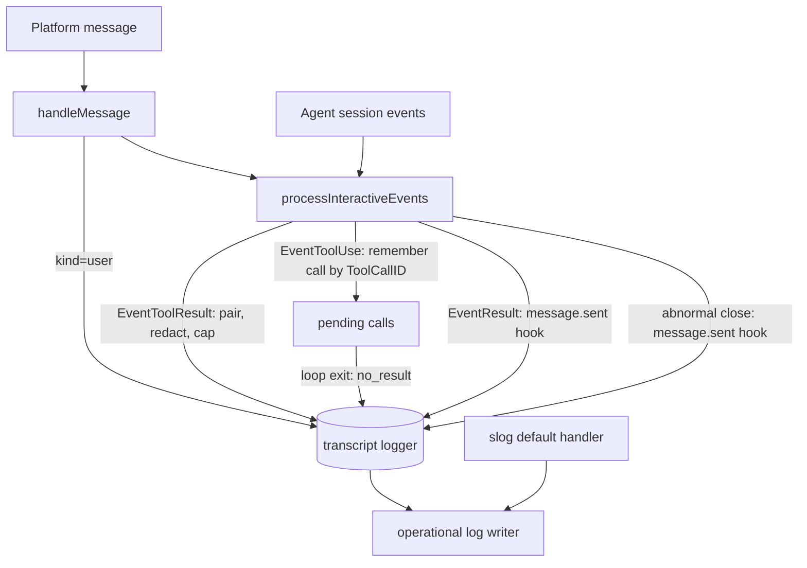

# Transcript Log for Replies and Tool Calls - Plan

## Goal Capsule

- **Objective:** An operator can review one prod chat session of the RegioTV content-bot from
  Loki alone: every user message and reply in full, and every tool call with its input, outcome
  and duration.
- **Means:** an opt-in transcript log in cc-connect, off by default, built on `downstream`,
  written by its own logger next to the operational log (KTD1).
- **Product authority:** [lovelysystems/ch#2398](https://github.com/lovelysystems/ch/issues/2398).
  Needed for the RegioTV launch on 1 December 2026.
- **Authority order:** this Product Contract, then the Key Technical Decisions, then the units.
- **Execution profile:** one PR into `downstream`, four units in dependency order.
- **Stop conditions:** stop and ask if a record cannot carry the session key at its emit point,
  or if Claude Code's tool calls cannot be paired by call ID.
- **Finishing:** the implementer opens the PR. Turning the switch on for the content-bot happens
  in `ch-content-bot` after release (see Deferred to Follow-Up Work).
- **Open blockers:** none.

---

## Product Contract

Product Contract preservation: changed R4, R7 — R4 records the reply as delivered to chat at
the `message.sent` hook, so the log matches what the user saw; R7 names the redactor ported
from upstream, because the existing one only handles argv lists. Both approved by the user.

### Summary

A new config switch turns on a transcript log. When it is on, cc-connect writes every user
message, every reply as delivered to chat, and every tool call to the same output as its
operational log. Debug-level logging no longer carries chat text. The noisy per-event lines of
the Claude Code agent go away.

### Problem Frame

Today the bot's prod logs cut each reply at 500 characters and never name the tools it calls.
On 24 November, 17 of 27 replies were longer than that, so the end of each one was lost: the
bot's question, its explanation, its next step. Nobody can tell which command was denied in
don't-ask mode (7 times so far), which `content` subcommand failed, or why one title lookup
took 25 tool calls and 79 seconds.

At the same time, upstream (chenhg5/cc-connect) is removing content from logs, at Debug level
too. It merged about 15 redaction PRs on 24–25 November and added a CI gate (`cmd/logcheck`)
that rejects payload variables in `slog` calls. Open PR #2330 would strip every slog attribute
that is not on an allowlist. A change that widens content in the operational log conflicts
with that direction, and once #2330 lands upstream, our rebases would strip such content
without any error.

### Key Decisions

- **Build on `downstream` now; propose upstream later as an issue, not a PR.** Upstream's
  current rule forbids content in logs, and an upstream PR could not merge before the launch.
  (session-settled: user-approved — chosen over an upstream PR first: it argues against the
  maintainer's redaction sweep and misses 1 December)
- **A dedicated switch, not a log level.** A trace level would mix content with other trace
  output, and #2330's allowlist would strip it. A switch that names what it turns on is also
  the shape we would propose upstream. Governs R1, R2. (session-settled: user-approved —
  chosen over a new trace level: same cost, and survives upstream's allowlist)
- **One switch named `transcript`, covering messages and tool calls.** A session review needs
  both, and both carry the same kind of content. Governs R1. (session-settled: user-approved —
  chosen over separate switches for messages and tool calls, and over the name `conversation`:
  prod would always set both, and `conversation` reads as messages only)
- **Replace the 500-character debug lines for replies and user messages.** Keeping them would
  log chat text twice and leave it at debug. Governs R3, R4, R8. (session-settled:
  user-approved — chosen over leaving the lines alone to avoid rebase conflicts, and over
  keeping user messages at debug: the conflict is small, and a reviewed session needs both
  sides in full)
- **The reply record is what the user saw, taken where the `message.sent` hook fires.** The
  log has to recreate the real conversation. Governs R4. (session-settled: user-directed —
  chosen over all assistant text of the turn: it includes text quiet mode never delivered; and
  over logging at every outbound platform send: about 80 send sites, streaming-card edits and
  session plumbing for the launch window)
- **Agent-agnostic, in core.** Every agent already reports tool calls and results to the
  engine, so the transcript log works for all agents and stays proposable upstream. The agent
  supplies what only it knows, such as the call ID that pairs a call with its result.
  Governs R5.

### Requirements

**Switch and output**

- R1. `transcript = true` under `[log]` turns the transcript log on for user messages, replies
  and tool calls together. It is off by default, and existing configs behave exactly as before.
- R2. When on, transcript records go to the same output as the operational log, whatever the
  log level, and survive a slog attribute allowlist. Each record is filterable in LogQL as its
  own kind and carries the session key.

**What is recorded**

- R3. Every inbound user message is recorded in full.
- R4. Every reply is recorded in full as delivered to chat, once per turn: after display-mode
  filtering and NO_REPLY handling, without the reply footer. A silent turn has no reply record.
- R5. Every tool call is recorded with: the tool name, its input summary capped at about 300
  characters, ok or error, the exit code when the agent reports a real one, and the duration
  from call to result. Durations stay correct when tools run in parallel.
- R6. An errored tool call also carries the start of its error text, capped like the input, so
  a permission denial can be told apart from a failed command.
- R7. Tool input and error text pass through the tool-text secret redaction ported from
  upstream PR #2160 before they are recorded.

**Removed noise**

- R8. The debug lines `turn response` and `message content` are removed. With the switch off,
  no log line carries user or reply text.
- R9. The Claude Code agent no longer writes one `claudeSession: event type=…` debug line per
  stream event.

### Acceptance Examples

- AE1. Switch off. **Covers R1, R8.**
  - **Given** the switch is unset and `log.level = "debug"`,
  - **When** a user sends a message and the bot answers with a 2,000-character reply after
    three tool calls,
  - **Then** the log has no user text, no reply text and no transcript records.
- AE2. Switch on, parallel tools. **Covers R2, R5.**
  - **Given** the switch is on and `log.level = "info"`,
  - **When** the agent runs two Bash commands in parallel and the second one finishes first,
  - **Then** two tool-call records appear, each with its own command and its own duration.
- AE3. Denied command. **Covers R5, R6.**
  - **Given** the switch is on and the bot runs in don't-ask mode,
  - **When** the agent tries a command outside its allowlist,
  - **Then** the tool-call record shows the command, the outcome error, and the start of the
    denial message.
- AE4. Quiet mode with pre-tool text kept. **Covers R4.**
  - **Given** the switch is on and the project runs `mode = "quiet"` with
    `prepend_pre_tool_text = true` and `reply_footer = false`,
  - **When** the agent writes text, calls a tool, then writes more text,
  - **Then** one reply record holds both texts exactly as the chat message shows them.

### Scope Boundaries

- Logging inbound attachments (type, name, size) and session restores is deferred. The issue
  marks both optional.
- A per-project switch is deferred. One global switch covers the content-bot.
- Tool output beyond the error excerpt in R6 is not recorded.
- What the user sees but the reply record leaves out: the reply footer, error and command
  answers (for example "agent timed out" or `/help`), and the text sent before each tool call
  when `tool_messages` or compact mode is on. The content-bot runs none of these.
- Turns outside the normal turn loop are not recorded: output after a turn ends, `/compress`
  and relay turns. Cron, timer, heartbeat and webhook prompts get no user record; their
  replies do. A voice message is recorded as received, before transcription.
- The switch is not hot-reloaded and not exposed in the management API, the same as
  `log.level`.
- Considered and not built:
  - Timestamping events in the agent to remove platform-send time from durations. Core
    receipt time locates slow calls well enough; build it if prod durations disagree with
    Claude's own timings by more than a second.
  - Removing the `claudeSession: tool error` debug line, which still logs full error text at
    debug. It is tool output, not chat text, and upstream already changed it; it drops at the
    next upstream sync.

#### Deferred to Follow-Up Work

- Set `[log] transcript = true` in `ch-content-bot/docker/config.default.toml` once this
  release is pinned there.
- Open the upstream issue proposing the transcript log, citing prod examples, after launch.

### Dependencies / Assumptions

- Loki collects cc-connect's stdout on op-prod. The transcript log adds no shipping config.
- Claude Code's stream sends `id` on each tool call and `tool_use_id` on its result.
  `agent/claudecode/session.go` reads neither yet.
- Claude Code reports no numeric exit code in its stream. A failed Bash call's result text
  starts with `Exit code N`. Other tools carry only `is_error`.

### Sources / Research

- Downstream code: `core/engine.go` (`handleMessage`, `processInteractiveEvents`, the two
  `HookEventMessageSent` emits, `formatToolResultEventFallback`), `core/message.go`
  (`core.Event`), `core/redact.go`, `agent/claudecode/session.go` (`handleReadLoopLine`,
  `handleAssistant`, `handleUser`), `agent/claudecode/claudecode.go` (`summarizeInput`),
  `config/config.go` (`LogConfig`), `cmd/cc-connect/main.go` (`setupLogger`).
- Upstream redaction direction: chenhg5/cc-connect PRs #2410, #2411, #2412, #2420
  (`cmd/logcheck` CI gate), open #2330 (slog allowlist that also redacts `msg` and moves the
  log to stderr).
- Upstream call IDs and tool-text redaction: chenhg5/cc-connect open PR #2160 (approved,
  mergeable on 26 November), `core/tool_progress.go` `RedactToolText`, `core.Event.ToolCallID`.

---

## Planning Contract

### Key Technical Decisions

- KTD1. **A separate transcript logger on the operational writer.** `main.go` builds a
  `*slog.Logger` with a plain text handler on the same writer `setupLogger` uses, at a fixed
  level, only when the switch is on, and hands it to every engine through a setter (nil means
  off). #2330 redacts every attribute and `msg` on the default handler, so content only
  survives on a handler it never wraps. Upstream's `cmd/logcheck` only checks package-level
  `slog.*` calls, so method calls on this logger pass it. The writer is `logWriter`, or
  `os.Stdout` when it is nil (no `CC_LOG_FILE`), the same fallback `setupLogger` applies; a
  nil writer would panic on the first record. Taking it from the same variable keeps both logs
  together if upstream moves the log to stderr. Governs R1, R2.
- KTD2. **Record shape.** Every record has `msg=transcript`, `kind` (`user`, `reply`, `tool`),
  `project` and `session_key`. Reply and tool records also carry the cc-connect session ID and
  the agent's session ID when known. The session key is the join key: the user record is
  written before the turn has a session. In multi-workspace mode the turn loop's key is
  `<workspace>:<platform key>`; every record carries the unprefixed platform key, and reply and
  tool records add `workspace`, so one key filter returns the whole session. Records use the
  same logfmt text as the operational log, so one LogQL `| logfmt` parser reads both.
  Governs R2.
- KTD3. **User record at message arrival.** Written in `handleMessage` beside the
  `message.received` hook, with the content that hook gets; it replaces the `message content`
  debug line. Governs R3, R8.
- KTD4. **Reply record at the `message.sent` hook.** Written at both emits (normal turn end and
  abnormal agent exit) with the content the hook gets; the first replaces the `turn response`
  debug line. Governs R4, R8, and inherits the reply Key Decision's label.
- KTD5. **Tool pairing in core by call ID.** `core.Event` gains `ToolCallID`, named as in
  upstream #2160 so the later sync is a no-op there. `processInteractiveEvents` keeps a
  turn-local map of pending calls (name, redacted input, receipt time) and writes one tool
  record per result, at the top of the event case, before any display gating. Edge cases:
  - A result with no matching call is recorded without a duration.
  - Calls still pending when the turn loop exits are recorded with outcome `no_result`.
  - A result with an empty call ID pairs only when exactly one call of that tool name is
    pending; otherwise it is recorded without a duration.
  - Exact pairing needs the agent to set `ToolCallID`; this change sets it for Claude Code
    only. Other agents get best-effort records (unmatched results, `no_result` calls, ACP's
    per-chunk results), which is accepted and does not trigger the stop condition.
  - Outcome is `error` from `ToolSuccess=false` or a failed/error `ToolStatus`, `ok` from the
    opposite, `unknown` when the agent reports neither.

  Governs R5, R6.
- KTD6. **Port `RedactToolText` verbatim.** Same name, signature and regexes as upstream #2160,
  in its own core file; if #2160 lands, the duplicate definition fails to compile and our copy
  is dropped. Input and error text are redacted first and capped at 300 runes after, so a cap
  never leaves half a secret behind. Governs R6, R7. (session-settled: user-approved — chosen
  over running `RedactArgs` on whitespace-split input: it misses Bearer headers, `X_TOKEN=`
  assignments, URL credentials and JSON secret keys)
- KTD7. **Claude Code reports only real exit codes.** On an errored result, the agent parses a
  leading `Exit code N` into `ToolExitCode`; otherwise `ToolExitCode` stays nil. The synthetic
  0/1 code goes away, which also drops the exit line from chat tool notices when tool messages
  are on; `ToolSuccess` still drives ok/failed there. Governs R5. (session-settled:
  user-approved — chosen over keeping the 0/1 code: it would show as a real exit code in the
  transcript)
- KTD8. **Durations from core receipt time.** Measured when the turn loop reads the call and
  the result; the loop's own platform sends can add their latency to a call. When the agent
  runs calls from one batch one after another, a call's duration also includes the time it
  waited behind earlier calls. The tool record is written at result receipt, so its log
  timestamp gives per-call time from consecutive results. Governs R5.

### High-Level Technical Design

Where each record kind is written, relative to the existing engine flow:

---

## Implementation Units

### U1. Tool-text secret redaction

- **Goal:** core can redact secrets in free-form tool text.
- **Requirements:** R7.
- **Dependencies:** none.
- **Files:** `core/redact_tool.go` (new), `core/redact_tool_test.go` (new).
- **Approach:** copy `RedactToolText` and its unexported helpers and regexes from upstream PR
  #2160's `core/tool_progress.go`; nothing else from that file (KTD6).
- **Patterns to follow:** `core/redact.go` and `core/redact_test.go` for file shape and
  table-driven tests.
- **Test scenarios:**
  - `curl -H "Authorization: Bearer abc123" https://x` keeps the command, masks `abc123`.
  - `API_TOKEN=abc123 content publish 42` masks the assignment value, keeps the rest.
  - `git clone https://user:pw@host/repo` masks the user and password, keeps the host.
  - JSON input `{"api_key":"abc","query":"x"}` masks `api_key`, keeps `query`, stays valid
    JSON.
  - `--password hunter2` masks the flag value.
  - Text with no secret comes back unchanged.
- **Verification:** the four secret shapes from the decision above are masked in tests.

### U2. Transcript records in core

- **Goal:** the engine writes user, reply and tool records when it has a transcript logger,
  and writes no chat text at any log level when it does not.
- **Requirements:** R2, R3, R4, R5, R6, R8.
- **Dependencies:** U1.
- **Files:** `core/transcript.go` (new), `core/transcript_test.go` (new), `core/message.go`,
  `core/engine.go`, `core/engine_test.go`.
- **Approach:**
  1. Add `ToolCallID` to `core.Event` (KTD5).
  2. `core/transcript.go` holds the logger wrapper with one method per record kind, the
     pending-call map type and the input/error capping (KTD2, KTD5, KTD6).
  3. Add a setter on `Engine` mirroring `SetReplyFooterEnabled`.
  4. In `handleMessage`, replace the `message content` debug block with the user record
     (KTD3).
  5. At both `HookEventMessageSent` emits, write the reply record; delete the `turn response`
     debug block (KTD4). Delete `previewText`, whose only callers are the two removed blocks.
     Drop the `content_last30` attribute from the `appendReplyFooter` debug line, which
     otherwise logs the end of every reply at debug while the footer is on (R8).
  6. In `processInteractiveEvents`, record calls and results at the top of the
     `EventToolUse`/`EventToolResult` cases and flush pending calls when the loop returns
     (KTD5).
- **Patterns to follow:** setter-plus-field options such as `SetReplyFooterEnabled`; event
  stream tests such as `TestProcessInteractiveEvents_ToolSegmentsKeepFinalFooter`; slog capture
  in `core/cmdopts_test.go`.
- **Test scenarios:**
  - Covers AE1. Default logger at debug captured to a buffer, no transcript logger, reply
    footer on: a message through `handleMessage` and a turn with three tool calls and a long
    reply leave no user text, reply text or `msg=transcript` in the buffer.
  - Covers AE2. Two `EventToolUse` with IDs `a` and `b`, then the result for `b`, then `a`:
    two tool records, each with its own input and a duration from its own start.
  - Covers AE3. An errored result whose text is a denial message: record has outcome
    `error` and the start of the redacted denial text.
  - Covers AE4. Quiet mode with `PrependPreToolText`: text, tool use, text, result give one
    reply record equal to what the stub platform received, without footer.
  - A NO_REPLY turn writes no reply record.
  - The abnormal-close path writes one reply record with the delivered text.
  - A result with no preceding call is recorded with no duration.
  - A call with no result when the loop exits is recorded with outcome `no_result`.
  - Two sequential calls with empty IDs pair in order.
  - Two pending calls of one tool name with empty IDs: the first result is recorded without a
    duration.
  - Multi-workspace turn: user, reply and tool records carry the same platform session key.
  - An input over 300 runes is capped after redaction; a secret straddling the cap is still
    masked.
  - Every record carries `kind`, `project` and `session_key`; the user record's content
    equals the inbound message verbatim, multi-line text included.
- **Verification:** AE1–AE4 pass with a JSON handler on a buffer as the transcript logger.

### U3. Config switch and logger wiring

- **Goal:** `[log] transcript = true` turns the transcript log on for every project.
- **Requirements:** R1, R2.
- **Dependencies:** U2.
- **Files:** `config/config.go`, `config/config_test.go`, `config.example.toml`,
  `cmd/cc-connect/main.go`, `CHANGES.md`.
- **Approach:**
  1. Add a `Transcript` bool to `LogConfig`; zero value is off.
  2. In `main.go`, after `setupLogger`, build the transcript logger on `logWriter` or stdout
     when the switch is on (KTD1), and pass it to each engine in the per-project setup loop.
  3. Document the key under `[log]` in `config.example.toml`, with a note that it logs chat
     text in full.
  4. Add a Feature entry to `CHANGES.md` under Unreleased, appended after existing entries:
     the transcript log (upstream: pending), with the `RedactToolText` port marked
     `(backport: chenhg5/cc-connect#2160)`.
- **Patterns to follow:** `writeConfigFixture` and the `TestLoad_*` tests in
  `config/config_test.go`; the per-project setter calls in `main.go`.
- **Test scenarios:**
  - A config without `[log] transcript` loads with the switch off.
  - `[log]` with `transcript = true` and `level = "warn"` loads both values.
- **Verification:** a local run with the switch on and `level = "warn"` shows transcript
  records for one chat exchange; with it off, none.

### U4. Claude Code call IDs, exit codes and log noise

- **Goal:** Claude Code tool events pair by ID and carry only real exit codes; the per-event
  debug line is gone.
- **Requirements:** R5, R9.
- **Dependencies:** U2.
- **Files:** `agent/claudecode/session.go`, `agent/claudecode/session_test.go`.
- **Approach:**
  1. Read `id` on `tool_use` items and `tool_use_id` on `tool_result` items into `ToolCallID`.
  2. On an errored result, parse a leading `Exit code N` into `ToolExitCode`; leave it nil
     otherwise (KTD7).
  3. Delete the `claudeSession: event` debug line in `handleReadLoopLine`.
- **Patterns to follow:** the table in `TestHandleUserEmitsToolResult`, whose fixtures already
  hold `tool_use_id`.
- **Test scenarios:**
  - A `tool_use` with `id: toolu_abc` emits `EventToolUse` with `ToolCallID` `toolu_abc`.
  - A `tool_result` with `tool_use_id: toolu_abc` emits `EventToolResult` with the same ID.
  - An errored result starting `Exit code 128\n…` gives `ToolExitCode` 128 and
    `ToolSuccess` false.
  - An errored result without the prefix (a permission denial) gives nil `ToolExitCode`.
  - A successful result gives nil `ToolExitCode` and `ToolSuccess` true.
  - Update the existing 0/1 expectations in `TestHandleUserEmitsToolResult` to the above.
- **Verification:** Claude Code session tests pass; a local turn with parallel Bash calls
  shows paired tool records with their own durations.

---

## Verification Contract

| Check | Command or action | Proves |
|---|---|---|
| Build | `go build ./...` | Compiles with all agents and platforms |
| Unit tests | `go test ./core/ ./agent/... ./config/ ./cmd/... ./platform/... ./daemon/` | U1–U4; bare `go test ./...` fails on the git-excluded `sandbox/` dir |
| Race | `go test -race ./core/ ./agent/claudecode/` | Pending-call map and logger are safe across goroutines |
| Vet | `go vet ./core/ ./agent/... ./config/ ./cmd/...` | Standard checks |
| Core stays agnostic | grep `core/transcript.go` and `core/redact_tool.go` for agent and platform names | CLAUDE.md rule 1 |
| Local smoke | run with `transcript = true`, `level = "warn"`, send one message that runs two tools | One user, one reply and two tool records; no other content lines |
| Loki | after deploy: `{…} \| logfmt \| msg="transcript" \| kind="tool"` | R2 filterability in prod |

---

## Definition of Done

- All units' test scenarios exist and pass with the commands above.
- With the switch off, no log line at any level carries user or reply text (AE1).
- The `message content`, `turn response` and `claudeSession: event` lines are gone.
- `config.example.toml` and `CHANGES.md` describe the switch.
- No dead code from abandoned approaches remains in the diff.

---

## Risks

- **Line length.** A reply or input longer than the container runtime's line limit (16 KB on
  CRI) is split into partial lines before Loki sees it. Content-bot replies are far below it;
  check one long reply in Loki after deploy.
- **Upstream sync conflicts.** Upstream changed lines next to the tool-event cases and the
  Claude Code result parsing. #2160 touches the same `handleAssistant`/`handleUser` lines and
  adds `ToolCallID`; when it lands, keep upstream's version and drop ours.
- **Content in prod logs.** The switch puts chat text in Loki by design. Retention and access
  for that Loki tenant are an ops decision for the content-bot rollout.

---

## Deferred / Open Questions

Review items left for the author. They do not block implementation.

### From 2026-11-26 review

- **Tool outcome list in R5 omits two values the design uses** — R5 (tool-call record) (P2,
  coherence, confidence 75)

  Tests written from R5 (the tool-call record) expect only ok or error, but the design also
  records `unknown` when the agent reports no status and `no_result` when a call has no result
  by the end of the turn. Since the requirement wins over the design on behavior, an
  implementer could read R5 as forbidding both.
  Change: in R5, replace "ok or error" with "ok or error, or unknown when the agent reports
  neither, or no result when none arrives before the turn ends".

- **R1's "existing configs behave exactly as before" contradicts R8's removed lines** — R1
  (switch and existing configs) (P3, coherence, confidence 75)

  Operators running `log.level = "debug"` today lose the `turn response` and `message content`
  lines after the upgrade, which R1 (the switch) promises won't happen while R8 (removed noise)
  requires it. A reviewer checking R1 cannot tell the removal is intended.
  Change: in R1, replace "existing configs behave exactly as before" with "with the switch off
  nothing is written to the transcript log; R8 and R9 remove their debug lines for every
  config".
